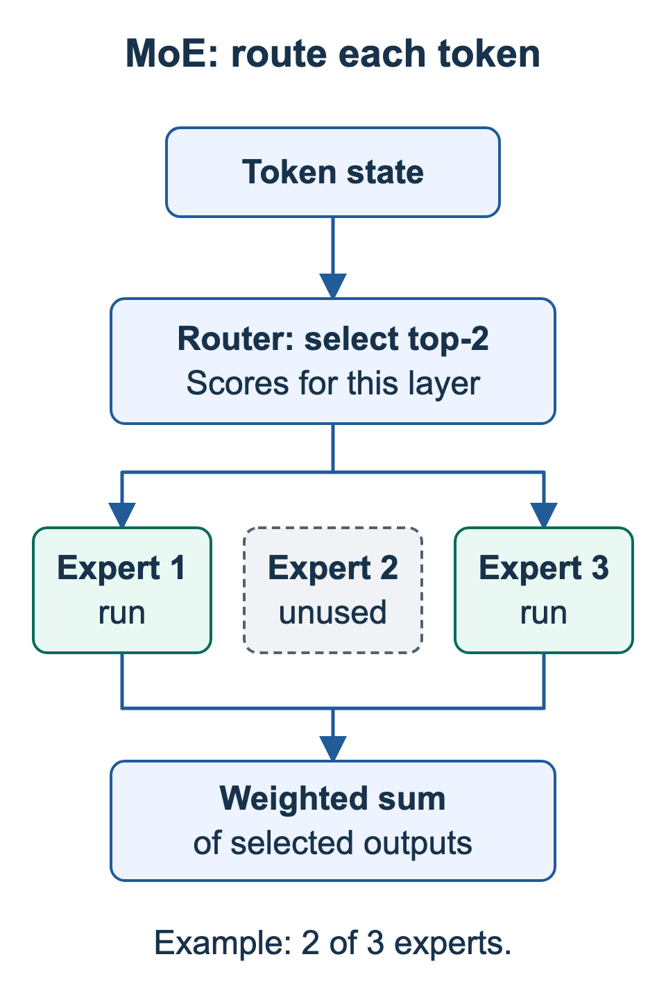

# Mixture of Experts (MoE) — Flashcards
Tags: #flashcards #ai-engineering #fundamentals #moe #llm
Verified on: 25 September 2026 — This factsheet lists products, versions or regulatory texts that are evolving quickly.
<!-- summary: total and active parameters, router, load balancing, shared expert, real specialization, memory cost, expert parallelism, MoE or dense, calculation of separate experts active in a batch, all-to-all communication, router imbalance. -->


What is a Mixture of Experts model? <!--anki:6a3348243e4677414e52-->
?
A Transformer Whose **MLP Block** is replaced by **several MLPs (“experts”)** and one **Router** who chooses, **for each token**, only a few experts (top-k, Often 1 TB 8 among dozens or hundreds). Only a fraction of the parameters **Work** to each token.

The activation is **sparse**, but the experts remain weights to store somewhere. Two tokens of the same sentence can solicit different experts, and a batch can mobilize a lot in total. So distinguish calculation by token, model memory and routing communications to understand the interest and cost of the MoE.

---

Do not confuse: Total parameters and active parameters? <!--anki:744144745570536d772c-->
?
- **Total**: All — experts determine the **memory** required.
- **Activities**: those used **by token** — they determine the **calculation** (FLOPs) and therefore part of the speed.

Example: a model of ~**670 B total parameters** but ~**37 B active** (order of magnitude of DeepSeek-V3).

Few active parameters therefore do not mean "stands on the GPU of a dense model of 37 B". Inactive experts must remain available, possibly distributed or unloaded; add KV cache, buffers and communications to the sizing.

---

Why is the MoE attractive for larger models? <!--anki:427b4855503445695067-->
?
The MoE It is attractive because it increases the **Total Model Capacity** without activating all its parameters for each token. This sparse activation can offer a better quality/calculation compromise than some dense architectures, According to the data, Training and budget compared.

It is not a universal guarantee of quality or speed. Experts take up memory, routing adds communications and the load can be unbalanced. For a deployment, compare models on the same tasks and SLO, with the cost of the GPU and the network, rather than only the active parameters.

---

How does the router of a MoE model work? <!--anki:68243021393e6371397e-->
?
A small linear layer calculates a **score per expert** for the token; we keep the **top-k** and combine their **weighted** outputs by these scores (after softmax). The routing is done **by token and per layer**: the same word can go to different experts at each layer.

Variants can use other standardizations or shared experts. Monitor Load: If the majority of tokens choose the same experts, some GPUs become the bottleneck. A routing score is not an interpretable business label.



[Diagram reference](https://arxiv.org/abs/2401.04088).

---

What is load balancing and why is it necessary? <!--anki:6b65265a7c4f75487231-->
?
Without constraint, the router **collapses** on some experts (the others are never trained) and some GPU are overloaded. We add an auxiliary balancing **loss**, or an adjustable **bias** per expert, and a maximum **capacity** of tokens per expert (the excess tokens are redirected or ignored).

The goal is to avoid both under-trained experts and queues focused on a few GPUs. The precise mechanisms vary depending on the architecture, including the processing of a capacity overrun. Monitor the distribution of tokens and times per expert; a good average balance can mask a temporarily very unbalanced batch.

---

What is a shared expert? <!--anki:493542434e742e2c5045-->
?
An expert **Always Active** for all tokens, In addition to the experts. He captures them **Common knowledge**, what leaves the experts routed **Specialize** more (DeepSeekMoE approach).

Sharing avoids asking each routed expert to relearn all common regularities, but it adds systematic calculation: even if only a few routed experts are chosen, the shared expert remains executed. Its content is not an explicitly labeled basis of facts; the distribution of knowledge is learned and imperfectly interpretable.

---

Are experts specialized by field (math, code, French)? <!--anki:736f6c3572507c7c512c-->
?
**Not really.** The analysis shows a specialization especially **syntactic or lexical** (punctuation, types of tokens) rather than thematic. "Expert" is a misleading name: these are **subnetworks learned** without a humanly interpretable role guaranteed.

The specialization observed depends on the model, the layer and the data studied; it is not necessary to generalize a result to all the MoE. The routing can follow local regularities rather than a business expertise, so we can not disable a supposed "legal expert" to properly remove all legal knowledge.

---

What is the hidden cost of a MoE in inference? <!--anki:706d666f3345467d2f48-->
?
The **Total memory of weights** and the **Routing Communications**. Activate few experts by token Reduce the calculation, not the number of experts to store somewhere.

Example: a model with 48 billion total parameters but 6 billion active does not have the weight footprint of a dense 6 billion. Offloading experts reduces resident VRAM at the price of transfers and latency.

A diversified batch can require a lot of experts; load imbalance and exchanges between GPU then become decisive. The bottleneck can be memory, network or calculation: measure rather than deduce the speed of only active parameters.

---

What is expert parallelism? <!--anki:4c6f3a3e59624f4b3a62-->
?
Distribute **Experts on different GPU** : each token is **sent** (all-to-all) to GPU who carries his experts, Then the result comes back. It is in addition to the tensor and pipeline parallelism; its **all-to-all communications** require fast interconnections (NVLink, InfiniBand[[62-inference-optimizations|Parallelism]], [[54-distributed-training|Distributed Training]]).

A GPU can host several experts, and an expert can be distributed according to the architecture. The challenge is to balance tokens received, calculation and communications. A popular expert creates an expectation for others; measure the overall throughput and network exchanges, because the addition of GPU can increase communication without speeding up processing.

---

MoE or dense: what to choose in self-hosting? <!--anki:6b30347c33712d463774-->
?
- **Dense**: Easier to serve, predictable, efficient at **low traffic** and on **a single GPU**.
- **MoE**: best quality/calculation ratio to **high traffic** if you have the **memory** (several GPU) and a well optimized server.

The [[68-quantization|quantization]] (especially from experts) reduces the memory gap.

These trends do not replace a measurement: some compact MoEs fit on a single machine, and a dense one may also require multiple GPUs. Fixing available memory, minimum quality, and load distribution, and then comparing start-up, throughput, and latency. Quantifying weights reduces storage but does not remove communications or the KV cache.

---

Calculation: for a MoE of 235B parameters stored at 1 byte each, including 22B active by token, estimate gross weight storage and linear calculation under the approximation 2 FLOP per active parameter? <!--anki:3665376632613631663333623433376161366631326166316565366464376231-->
?
Under the approximations of the statement:
```text
resident weight: 235e9 × 1 byte = 235 GB decimal
Linear calculation: 2 × 22e9 = 44 GFLOP by token
```
Storage depends on the parameters **Total**, the activated calculation of parameters **Active**. Add runtime memory, KV cache and margin before sizing them GPU. The 44 GFLOP excludes in particular the cost depending on the context, Routing and communications: this is not latency, nor the guarantee of a speed identical to a dense 22B. Measure useful flow and [[121-inference-costs|Cost]] on the targeted load.

---

Calculation: 16 tokens each chooses two experts out of eight, without a shared expert. How many separate experts can the batch solicit? <!--anki:3236363137376135636562633431303039616636623536663639353433646331-->
?
The minimum is **two experts**, if all tokens choose the same pair. The maximum is **eight**, if the 32 assignments cover all available experts.

The number of active experts per token remains two in both cases. The coverage of the batch however changes the weights requested and the distribution of communications. The calculation assumes two separate experts per token and ignores any capacity constraints or additional routing. It illustrates why "two active experts" does not mean that only two experts of the model are needed in memory for the entire batch.

---

What does a MoE expert who receives far more tokens than others reveal? <!--anki:6333333137316539663732353430393462313538313436383038613831643132-->
?
It can become **a computing or capacity bottleneck**, while other experts remain unoccupied. This concentration may reflect data or a routing problem.

Review the distribution by layer and by type of request, as well as the balancing mechanisms of the model. Implementations differ on handling overflow. Do not conclude a useful specialization from the received volume alone.

---

## Scenarios

Scenario: a Model MoE Announced " 37 billion active parameters” does not fit on your two GPU of 80 GB, While a dense model of 70 Billions held on to it. Explain. <!--anki:6737702e68314b6e2a35-->
?
1. **Distinguish active and total**: the active parameters determine the **calculation**, the totals determine the **memory**
2. **Consequence**: it is necessary to load **all the experts**, or hundreds of billions of parameters
3. **Options**: more than GPU, or expert quantization, which carry the bulk of the weights ([[68-quantization|quantization]])
4. **Anticipate the expert parallelism** : all-to-all communications require fast interconnection
5. **Check the real gain**: in big batch, almost all the experts are activated, and decoding becomes again limited by the memory

**Strap**: Sizing the VRAM from the number of active parameters.

---

Scenario: for a low traffic internal service on a single GPU, we offer you a recent MoE rather than a dense model. What do you recommend? <!--anki:6e4a266453757d695e37-->
?
1. **Look at the dominant constraint**: on a single GPU, it is the memory, and the MoE requires a lot of
2. **Low traffic**: the calculation gain of the MoE does not turn into visible gain
3. **Dense**: Easier to serve, more predictable, and often sufficient at this scale
4. **Reassess if the load rises**: at high traffic and with several GPU, the MoE becomes interesting
5. **Decide custom**: quality on your evals, latency and cost per request ([[121-inference-costs|costs]])

**Trap**: choose an architecture for its reputation rather than for the actual constraint of the deployment.

---

## Sources

- [Jiang et al. — Mixtral of Experts (2024)](https://arxiv.org/abs/2401.04088)

- Supplement of the 14 November 2026 — Routing and expert costs: [Fedus et al — Switch Transformers](https://arxiv.org/abs/2101.03961).

## Connections
- [[131-transformer-architecture|Architecture Transformer]] — the MLP block replaced
- [[135-pretraining-scaling-laws|Pre-workout & scaling laws]] — capacity vs calculation
- [[62-inference-optimizations|Inference optimizations]] — parallelism in serving
- [[12-kubernetes-gpu-inference|Kubernetes GPU & inference]] — deploy to multiple GPUs
- [[121-inference-costs|Inference costs]] — memory vs compute
- [[60-011-inference-capacity-scheduling|Capacity & scheduling]] — connect memory, budgets and payload under load
- [[00-moc-ai-engineering|MOC AI Engineering]]
