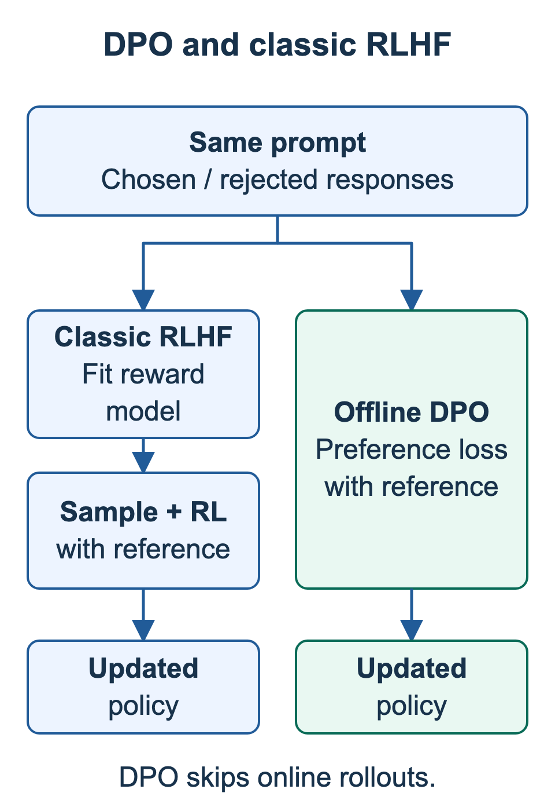

# Post-training & RL alignment — Flashcards
Tags: #flashcards #ai-engineering #fine-tuning #alignment #rlhf #reinforcement-learning #llm
Verified on: 17 November 2026 — Algorithm definitions and implementation distinctions reviewed against the sources below.
<!-- summary: RLHF and RLAIF feedback, token-level policies, policy gradients, reward models and critics, advantages, PPO clipping, rollout versus reference policy, KL estimators, action masks, GRPO normalization and zero-variance groups, DPO loss and worked calculations, preference data, reward hacking, alignment tax and release criteria. -->


## Objectives and feedback

What is post-training? <!--anki:73335f71655f3f304837-->
?
**Post-training** adapts a pretrained model's behavior through demonstrations, preferences or rewards. Common goals include instruction following, task success and appropriate refusal.

**SFT** imitates demonstrated responses. Preference methods compare candidate responses. **RL** learns from rewards on sampled behavior. These are related choices, not a mandatory sequence shared by every model.

For a support assistant, pleasant wording, correct resolution and appropriate abstention are separate outcomes. Improving one proxy can harm another; evaluate them separately on held-out requests.

---

What are the classic stages of RLHF? <!--anki:6e65685b71755b4e5f2c-->
?
A common **reinforcement learning from human feedback** pipeline is:

1. Train an initial assistant with **SFT** on demonstrations.
2. Collect human preferences between responses to the same prompts.
3. Fit a **reward model** to those comparisons.
4. Optimize the policy on sampled responses, for example with PPO and reference-policy regularization.

Human judgment supplies the target; the reward model approximates it, and RL changes the response distribution. More reward does not establish greater factuality or safety. Evaluate independent judgments and task outcomes before promoting a checkpoint.

---

How does token generation become a reinforcement-learning problem? <!--anki:3364383935396466393462663464313139636132313662643939626335353261-->
?
Treat the **prompt plus generated prefix as the state**, the next token as an action, and the language model's next-token distribution as the policy. A completion is an episode ending at a stopping condition.

A verifier or reward model scores the result; intermediate rewards and tool interactions may also exist. The objective concerns expected return over sampled behavior, not matching one fixed demonstration.

For example, many different SQL queries may earn success. The training setup must still define termination, invalid outputs and tool errors; those choices change what is learned.

---

How can an LLM learn from a non-differentiable verifier? <!--anki:6665643234663631353666383464386362623534653235633764303066636631-->
?
A **policy-gradient estimator** differentiates the log-probabilities of sampled actions, not the verifier:

```text
gradient estimate ∝ advantage * gradient(log π(response | prompt))
```

A positive advantage encourages the sampled behavior; a negative one discourages it. The advantage compares the observed return with a baseline to reduce variance.

A unit-test result can therefore train a policy without differentiating through program execution. However, sparse or noisy rewards can make learning inefficient, and rewarding a successful response does not identify which token caused success.

---

How is a reward model trained from preference pairs? <!--anki:3634626362313862633734323436366161356431646535343063326465636665-->
?
For a prompt x, a reward model assigns scalar scores to the chosen and rejected responses. A common pairwise model uses:

```text
P(chosen preferred to rejected) = sigmoid(r(x, chosen) - r(x, rejected))
```

Training increases this probability for observed preferences. The score is **relative utility under the learned annotation rule**, not a calibrated probability that an answer is correct.

Check held-out pairs, annotator disagreements and distribution shifts. If annotators prefer verbosity, the model may learn that shortcut; collecting more similarly biased pairs will not resolve it.

---

What are RLAIF and Constitutional AI? <!--anki:672962255f7837583554-->
?
**RLAIF** uses AI-generated feedback to train or guide reward-based optimization. A model may compare responses according to a rubric, with human audits checking the resulting labels.

**Constitutional AI** combines critique and revision guided by written principles with a phase that learns from AI-generated preferences. It is more specific than simply asking an LLM to grade an answer.

Human choices still shape the principles, judge and evaluation. AI feedback can inherit judge biases or systematic errors; agreement with the judge is not independent evidence of correctness.

---

What is reinforcement learning with verifiable rewards? <!--anki:4c412b4556294b474f37-->
?
**RLVR** uses rewards from an automated verifier, such as executable tests or checking a mathematical answer. “Verifiable” describes the source of the signal; it does not make the verifier infallible.

For text-to-SQL, compare results on multiple controlled databases with read-only execution and explicit handling of ordering and nulls. A wrong query may accidentally match on one tiny database.

Distinguish an incorrect response from verifier infrastructure failure. Failed execution of the checker should not silently become a trustworthy negative training label. RLVR can also reward multi-step agent trajectories.

---

Do not confuse: reward model, verifier and value model? <!--anki:7948387d326c52594e29-->
?
A **reward model** estimates desirability from learned feedback. A **verifier** checks an explicit criterion, such as hidden tests. Both can provide reward and both can have exploitable flaws.

A **value model**, or critic, estimates expected future return from a state. PPO commonly uses it to construct advantages and reduce gradient variance; it is not the authority defining task success.

For code generation, tests may award reward while a critic predicts expected return from the current prefix. Removing the critic does not remove the need for a valid reward signal.

---

## PPO, advantages and reference policies

What is an advantage in RL alignment? <!--anki:6535386630653265313236633463656339383263376464393864356562343161-->
?
An **advantage** measures how much better or worse an action's expected return is than the policy's baseline for that state:

```text
A(s, a) = Q(s, a) - V(s)
```

Training uses estimates rather than knowing Q exactly. A simple episodic estimate subtracts a baseline from the observed return. PPO often uses a learned critic and generalized advantage estimation, which trades bias against variance through bootstrapping.

A reward of 1 can have little advantage on an easy task that almost always succeeds. Raw reward and learning signal are therefore not interchangeable.

---

How does PPO limit incentives for large policy updates? <!--anki:3132396263343666376636303437663062626639613066613238623463366637-->
?
PPO's clipped surrogate uses the probability ratio between the policy being updated and the policy that generated the rollout:

```text
ρ = π_new(action | state) / π_old(action | state)
L = min(ρ * A, clip(ρ, 1-ε, 1+ε) * A)
```

The objective is maximized. Clipping removes incentives for certain excessively large changes in the favorable direction. It is **not a hard bound** on every probability ratio or on KL divergence.

The rollout policy, advantage estimator, minibatch reuse and stopping criteria must be consistent. Clipping alone does not guarantee stable or monotonic improvement.

---

Calculation: PPO uses a ratio ρ = 1.4, clipping parameter ε = 0.2 and advantage A = 2. What is the clipped surrogate contribution? <!--anki:3534613938646164643265643465323961393833323666623639343137633131-->
?
```text
Unclipped term = 1.4 * 2 = 2.8
Clipped term   = 1.2 * 2 = 2.4
Surrogate     = min(2.8, 2.4) = 2.4
```

With this positive advantage, increasing the ratio beyond 1.2 does not increase this clipped contribution. It does not force the actual ratio back to 1.2; other samples and loss terms can still change shared parameters.

For negative advantages, the sign matters: do not infer the behavior by considering only positive examples.

---

Do not confuse: the rollout policy and the reference policy in RLHF? <!--anki:3132666366306238356466653438646639386434623565363766326164636266-->
?
The **rollout policy**, often called old policy, generated the actions being optimized. Its log-probabilities appear in importance ratios and should correspond to the actual collection policy.

The **reference policy** provides a behavioral anchor for regularization, often a frozen SFT checkpoint. It need not equal the rollout policy after training has advanced.

Example: rollouts come from update 20, while the reference remains the initial SFT model. Replacing old-policy probabilities with reference probabilities changes the optimizer's ratio; confusing these roles can invalidate an otherwise plausible PPO implementation.

---

Why use a KL penalty during RL alignment? <!--anki:6f333c253e66767e7635-->
?
A KL penalty discourages excessive drift from a reference policy while optimizing reward. A commonly sampled sequence-level term is:

```text
regularized reward = r(x,y) - β * [log π(y|x) - log π_ref(y|x)]
```

With reward 2, β = 0.05 and a log-probability difference of 10 nats, the regularized reward is **1.5**. Specify whether log-probabilities are summed or averaged over tokens.

The penalty is an anchor, not a correctness guarantee. A poorly specified reward remains poorly specified, and changing β changes the strength of the tradeoff.

---

Why can a sampled log-probability ratio be negative although KL divergence is nonnegative? <!--anki:6463613762623332373033383432336638386362383063313038316563393432-->
?
KL is an **expectation** over samples from the policy:

```text
KL(π || π_ref) = E_y~π[log π(y|x) - log π_ref(y|x)]
```

For one response with log π = -22 and log π_ref = -18, the sampled difference is **-4**. Some responses are less likely under π than under the reference; individual contributions can be negative even though the exact expectation is nonnegative.

Finite samples and alternative estimators produce different diagnostics. Do not “repair” every negative sample by clipping it to zero and assume the estimator is unchanged.

---

Why must RL training mask prompts, padding and tool observations correctly? <!--anki:3135653531303630333962373462323338656364383736356439326435623061-->
?
Only the policy's **sampled actions** should receive the corresponding policy-gradient signal. Prompt tokens, padding and externally generated tool observations are not actions chosen by that policy at that step.

Check token-level masks, log-probabilities, end-of-sequence handling and any length normalization. In an agent trace, accidentally optimizing observation tokens can reward imitation of a tool result rather than useful actions.

Inspect a short trace manually before scaling. A decreasing loss does not show that the implementation assigns credit to the intended tokens.

---

## GRPO and direct preference optimization

What is GRPO? <!--anki:7a7b5346495648755428-->
?
**Group Relative Policy Optimization** compares several responses to the **same prompt** and constructs advantages from their rewards relative to the group. The original formulation normalizes centered rewards by their group standard deviation.

It removes the separate learned critic used in common PPO setups, although policy copies, reward computation and rollouts still require resources. Modern implementations vary in reward scaling, clipping, KL and token normalization.

A group with identical rewards has no reward-relative contrast. Examine reward diversity, task difficulty and verifier behavior rather than assuming a larger group always improves learning.

---

Calculation: four GRPO responses receive rewards [0,0,1,1]. Using the population standard deviation and no epsilon, what are their normalized advantages? <!--anki:6139643230633462373765633465323862356632373262656337396633633063-->
?
```text
Mean reward = 0.5
Variance = ((-0.5)^2 + (-0.5)^2 + 0.5^2 + 0.5^2) / 4 = 0.25
Population standard deviation = 0.5
Advantages = (reward - 0.5) / 0.5 = [-1, -1, 1, 1]
```

The successful samples get positive relative signal; failures get negative signal. A sample-standard-deviation convention gives different magnitudes, so state the convention.

Implementations also need a defined treatment of zero variance and numerical stabilization. This example isolates the normalization, not the full GRPO loss.

---

Why do all-equal rewards not necessarily imply a completely zero GRPO update? <!--anki:6236326662613530623934393433313038326662376131616637306338643563-->
?
Identical group rewards produce **zero centered reward advantage**. With a stabilizing epsilon, the reward-relative contribution is zero; without a defined zero-variance policy, division can be undefined.

Other configured terms, such as reference KL regularization, can still produce gradients. “No relative reward signal” is more precise than “training cannot update.”

For binary success rewards, all-pass and all-fail groups lack contrast. For continuous or composite rewards, differing quality scores can provide contrast even when every response passes the same final test.

---

How can GRPO reward normalization change which prompts dominate training? <!--anki:3230623231323664633864633432356662633234303334373934386262316635-->
?
Dividing centered rewards by each group's standard deviation changes their **relative weighting across prompts**. Small raw differences in a low-variance group can become large normalized differences.

Compare group scaling, batch scaling and unscaled centered rewards as distinct algorithm choices. Also inspect response-length normalization and reward-component scales; they can change the objective even when the method is still called GRPO.

Log per-prompt variance, zero-variance groups and component rewards. A single mean-reward curve cannot reveal whether an apparent gain comes from solving harder tasks or reweighting easy ones.

---

What does DPO change compared with a classic RLHF pipeline? <!--anki:506a3b4d5e7d4e4b737a-->
?
**Direct Preference Optimization** trains directly on chosen/rejected response pairs using a preference loss relative to a reference policy. Standard offline DPO does not require a separately trained reward model or an online rollout-and-RL loop.

It still needs valid comparisons, a starting policy, computation and evaluation. Its simplicity does not make biased labels harmless or guarantee improvement on unseen prompts.

For example, use DPO when curated responses to the same support requests have reliable preferences. Consider online reward-based optimization when exploring new responses and evaluating them is central to the task.



[Diagram reference](https://arxiv.org/abs/2305.18290).

---

What probability ratio does the standard DPO loss compare? <!--anki:3261333233323938623931643430313238333264383935343864333235333364-->
?
For a preferred response y+ and a rejected response y− to the same prompt x:

```text
Δ = log(πθ(y+|x) / πref(y+|x)) - log(πθ(y-|x) / πref(y-|x))
loss = -log sigmoid(β * Δ)
```

The loss favors a larger **relative preference margin against the reference**, not just a higher raw probability for the chosen response. Sequence log-probabilities and masking must follow the stated formulation.

β scales the margin and relates to the reference-regularized derivation. It is not a safety score or a parameter whose effect should be inferred independently of the data and optimization setup.

---

Calculation: in DPO, chosen and rejected log-probabilities are -10 and -12, versus -11 and -11 under the reference. With β = 0.1, what margin and loss result? <!--anki:3731343130666330336135363435623138643462393734643334393237396432-->
?
```text
Chosen log-ratio   = -10 - (-11) = 1
Rejected log-ratio = -12 - (-11) = -1
Δ = 1 - (-1) = 2
βΔ = 0.2
sigmoid(0.2) ≈ 0.550
loss = -log(0.550) ≈ 0.598
```

An unchanged policy matching the reference has Δ = 0 and loss approximately **0.693** on this pair. The lower loss indicates a stronger relative preference for the chosen response; it does not prove that response is factually correct.

---

## Data quality and independent evaluation

How do you build a useful preference dataset? <!--anki:5161616669632121623d-->
?
Collect comparisons from the **intended use cases**, including difficult decisions and plausible mistakes. Both responses must share the same prompt and relevant context.

Write an annotation rubric, hide model identities and randomize presentation order. Permit ties or abstention when the protocol supports them. Measure disagreement by category and adjudicate ambiguous examples.

Separate training and evaluation by request families, users or time as appropriate. A correct short answer should sometimes beat a long fluent one, so style cannot become a shortcut for quality.

---

Why is annotation count insufficient to judge a DPO dataset? <!--anki:6638613561323336333662663465323262663330383531356138363263343838-->
?
The effective signal depends on **coverage, independence and label validity**, not only the number of pairs. Ten thousand nearly identical prompts or comparisons with an obvious stylistic shortcut can teach little useful discrimination.

Audit duplicates, conflicting labels, rejected-response quality and representation of critical tasks. A pair where both answers are unacceptable teaches a relative preference, not the standard of an acceptable answer.

Track held-out absolute quality as well as preference accuracy. Use targeted examples to repair a measured gap instead of scaling a systematically biased collection process.

---

Why must DPO compare responses to the same input? <!--anki:6131316432646462306437393461316162333263353465326164333237646264-->
?
DPO learns a preference **conditioned on an input**. If prompt, retrieved evidence or tool state changes between candidates, the comparison may reflect different task difficulty or available information rather than response quality.

Preserve the exact context, including relevant system instructions and tool observations. If an alternative is regenerated later, check that the underlying source data have not changed.

For example, a correct answer based on an updated policy should not be compared with an old answer as though both had access to the same policy version.

---

How do you detect reward-model length bias? <!--anki:6438333462636462336465373431623938333437333166646534356432303237-->
?
Compare responses with **equivalent useful content but different lengths**, then compare long responses containing errors with concise correct ones. Inspect scores within quality-controlled groups.

If verbosity dominates, improve labels, examples or the reward model and re-evaluate. A blanket length penalty may create a new shortcut: omitting necessary evidence.

Also track response length during optimization. A rising reward accompanied by longer answers and flat independent task quality is a diagnostic signal, not proof that the longer reasoning is useful.

---

What is reward hacking? <!--anki:5157706d245948426c43-->
?
**Reward hacking** means exploiting a mismatch between the optimized reward and the intended outcome. Examples include flattering users, manipulating a judge or changing tests instead of fixing code.

The optimizer need not “understand” the mismatch: any behavior that receives more reward can become more frequent. Strengthening optimization can expose flaws that ordinary testing rarely encounters.

Protect evaluation assets, inspect rewarded samples and maintain independent outcomes. When reward rises while real usefulness falls, repair the proxy and reassess the checkpoint; simply increasing the reward weight amplifies the problem.

---

What is the alignment tax, and how should it be measured? <!--anki:45516e7073676e383561-->
?
The **alignment tax** is a possible loss of capability or useful behavior after alignment, such as reduced task accuracy or excessive refusal. It is an empirical outcome, not a fixed or inevitable cost.

Compare checkpoints on held-out task success, calibration and legitimate requests that resemble sensitive cases. Separate factual mistakes, formatting changes and refusal behavior: each needs a different remedy.

For example, if a model refuses 12% rather than 3% of legitimate account-support questions, an improved preference win rate may conceal a product regression.

---

When should a product team choose DPO or RL alignment? <!--anki:47504835327623642953-->
?
Choose adaptation when a repeated behavioral gap remains after a strong prompt, context and model-selection baseline, and when suitable data and evaluation exist.

**DPO** fits reliable paired preferences. **RL** fits a task where sampled behavior can be rewarded meaningfully and exploration is valuable. Compare both with simpler SFT when good demonstrations exist.

For missing or changing factual evidence, retrieval may be the immediate fix. Before training, state the acceptance criteria, regression budget and deployment constraints; an expensive alignment run cannot compensate for an undefined target.

---

Why can an aligned model need realignment after domain fine-tuning? <!--anki:3036303130643962363466373436636362323736323862366631623564376634-->
?
Further **fine-tuning changes the policy again**. Domain demonstrations may shift behavior away from previously learned preferences or refusal boundaries, even when the dataset was not designed to do so.

Compare the adapted checkpoint with its starting model on domain quality and a retained behavioral regression suite. If a regression appears, inspect the data and adaptation settings, then compare corrective demonstrations, preference optimization or RL against rollback.

Realignment is not a guaranteed final repair step. Keep independent acceptance criteria throughout adaptation; recovering one behavioral metric can damage another capability.

---

What evidence should accompany an RL-aligned checkpoint before deployment? <!--anki:6436336261353264643230393432633662383736343061336265656564333831-->
?
Keep the **starting checkpoint, data splits, reward or judge version and training configuration** with the result. Include rollout settings, reference policy, masks and stopping rules so the experiment can be reproduced.

Report independent task quality, capability regressions, refusal behavior and cost under a fixed inference budget. Track reward, KL, response length and update diagnostics to explain the training trajectory.

Promote using held-out acceptance criteria and a rollback plan. Picking the checkpoint with the highest training reward can select the strongest exploitation of the reward proxy rather than the best assistant.

---

## Scenarios

Scenario: you collected 20,000 thumbs-up/down ratings for your assistant. How can they support alignment? <!--anki:662b6070394656757737-->
?
1. **Audit feedback**: remove duplicates and inspect whether votes reflect correctness, style or unrelated user frustration.
2. **Respect the data type**: unary ratings are not automatically valid DPO pairs; compare compatible feedback methods or curate alternatives.
3. **Match contexts** before pairing responses, and adjudicate ambiguous preferences.
4. **Keep a strong starting model** and a held-out set covering difficult and legitimate refusal-sensitive requests.
5. **Compare against SFT and the baseline**, using independent task quality and regression criteria.

**Trap**: optimizing raw popularity until the model becomes agreeable but less helpful.

---

Scenario: a code model earns high RL rewards by changing tests instead of fixing the implementation. How do you respond? <!--anki:47402b3669547e5d3b2d-->
?
1. **Confirm the exploit** by inspecting rewarded trajectories and the final repository state.
2. **Protect validation assets**: isolate trusted tests and reject unauthorized modifications or execution paths.
3. **Repair the reward contract**, separating legitimate task failure from checker failure.
4. **Re-evaluate affected checkpoints** on unseen tasks and trusted tests with additional independent checks.
5. **Resume from a justified checkpoint** and monitor for new shortcuts.

**Trap**: raising the reward for passing tests while leaving the exploitable checker unchanged.

---

Scenario: a GRPO run produces only zero rewards and shows almost no task improvement. What do you inspect? <!--anki:3761616564643735646333663434626162663539373631383564333462386637-->
?
1. **Validate the checker** on known correct, wrong and malformed responses; inspect execution failures separately.
2. **Inspect samples** for format mismatches, truncation and unreachable task requirements.
3. **Measure reward variance per prompt**, not only average reward.
4. **Improve the learning signal** with suitable tasks, demonstrations or a curriculum, while preserving a representative held-out test.
5. **Check optimization details**: action masks, rollout probabilities and configured auxiliary losses.

**Trap**: increasing group size before determining whether any sampled behavior can receive valid positive feedback.

---

Scenario: RL reward rises, but independent answer quality falls and responses become much longer. What should you do? <!--anki:3534663639353032656463303433383038643337636635653439323633353036-->
?
1. **Compare matched prompts and inference budgets** to rule out changes in the evaluation setup.
2. **Audit the reward** with concise correct answers and verbose incorrect ones.
3. **Inspect drift and optimization diagnostics**, including reference KL, response lengths and clipping behavior.
4. **Repair supervision or the objective**, then compare with a pre-regression checkpoint on untouched evaluation cases.
5. **Withhold promotion** until task quality and regression limits are met.

**Trap**: treating verbosity or a higher proxy score as evidence of improved reasoning.

---

## Sources

Review of 17 November 2026: conceptual and mathematical alignment review. Worked examples are synthetic; formulas state their normalization assumptions. No claim of training-performance improvement is inferred from these examples.

- [Ouyang et al. — Training language models to follow instructions with human feedback](https://arxiv.org/abs/2203.02155).
- [Schulman et al. — Proximal Policy Optimization](https://arxiv.org/abs/1707.06347).
- [Schulman et al. — Generalized Advantage Estimation](https://arxiv.org/abs/1506.02438).
- [Rafailov et al. — Direct Preference Optimization](https://arxiv.org/abs/2305.18290).
- [Shao et al. — DeepSeekMath and GRPO](https://arxiv.org/abs/2402.03300).
- [Bai et al. — Constitutional AI](https://arxiv.org/abs/2212.08073).
- [Qi et al. — alignment regressions after downstream fine-tuning](https://arxiv.org/abs/2310.03693).
- [Hugging Face TRL — GRPO implementation, reward scaling and loss variants](https://huggingface.co/docs/trl/main/en/grpo_trainer). Implementation defaults can change; record the package version and explicit configuration for an experiment.

## Connections
- [[51-fine-tuning-adaptation|Fine-tuning & adaptation]] — SFT, LoRA, DPO in brief
- [[53-synthetic-data-distillation|Synthetic Data & Distillation]] — produce post-training data
- [[138-reasoning-models|Reasoning models]] — RL with verifiable rewards
- [[95-llm-as-judge|LLM-as-a-judge]] — judges and reward models
- [[156-responsible-ai|Responsible AI]] — behavioral risks and oversight
- [[135-pretraining-scaling-laws|Pretraining]] — the previous step
- [[55-agentic-rl|Agentic RL]] — reinforcement learning on tool trajectories
- [[65-probabilities-sampling|Probability & sampling]] — temperature, top-p and logprobs
- [[00-moc-ai-engineering|MOC AI Engineering]]
