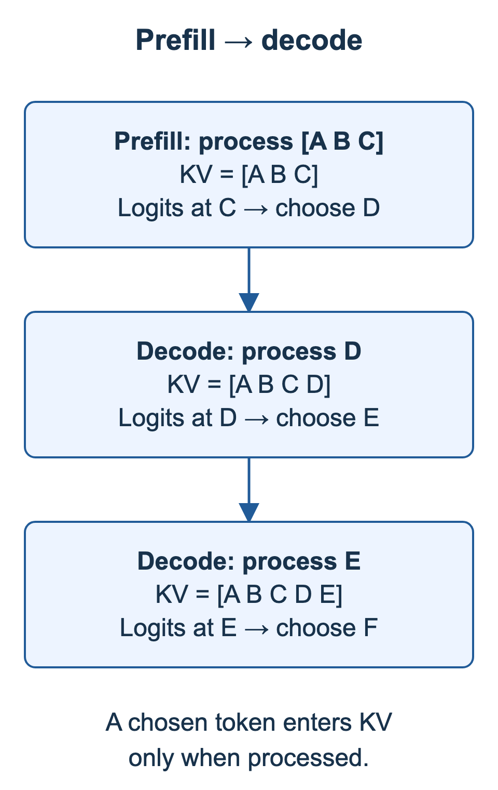

# Prefill & decode — Step by Step Execution — Flashcards
Tags: #flashcards #ai-engineering #inference #prefill #decode #attention #kv-cache
Verified on: 12 November 2026 — Causal Transformer mechanisms and documented sequencing; calculations are educational.
<!-- summary: Known positions and causal mask, Q/K/V projections, first token, cache timeline, attention cost, partial prefill, temporary memory, batching, chunked prefill, KV transfer and latency diagnosis, logs of the next token, padding masking. -->


What exactly does a prefill pass do on four known tokens? <!--anki:3831643765326339613135663432333761376634353336326166366334353465-->
?
For a **Transformer causal decoder-only**, the prefill transforms the four tokens of the prompt into internal states, layer by layer. Each layer calculates attention projections, masked attention and MLP block; residues and normalizations also participate in the result.

The keys and values of the four positions are kept for the following steps. The final state of the last position passes through the output head to obtain the logs of the next token. The prefill does not learn the weights and does not write four new tokens: it processes four entries already known to prepare the continuation.

---

Why can the positions of the prompt be calculated together without knowing the next tokens generated? <!--anki:3661613834333137373535383462373438633032326566333332343263373534-->
?
The input **tokens are already fixed**: the model knows their identity before the calculation. In a layer, their projections and authorized interactions can be expressed in matrix operations, with a causal mask.

The token of position three does not read that of position four, even if both are calculated in the same pass. The layers remain successive: the next one consumes the states of the previous one. In ordinary generation, the next token is not yet chosen; it must be selected before being provided in the next step. Parallelism of known positions and dependency of outputs are compatible.

---

How to read the prefill causal mask for four positions? <!--anki:6230316461313530623965353434313061396233396233333065376430323866-->
?
The **line** represents the position that interrogates; the **column** the position consulted. A causal mask allows the past and the current position, according to the standard convention illustrated:
```text
           Keys: x1 x2 x3 x4
request x1 ✓ × × ×
request x2 ✓ ✓ × ×
request x3 ✓ ✓ ✓ ×
request x4 ✓ ✓ ✓ ✓
```
Prohibited scores are excluded from the softmax; the allowed weights of each line are normalized. There are ten allowed pairs here, i.e. `4×5/2`. This educational matrix describes dense causal attention; slippery windows or specialized masks change connections and cache needs.

---

What do Q, K and V represent during the prefill of an attention layer? <!--anki:6239633438616530346163323430633562353166643536623236346262303761-->
?
From the `H` states of the layer, learned **projections** produce the `Q` queries, `K` keys, and `V` values.
```text
scores = Q × KT / √head_dimension + mask
output = softmax(scores) × V
```
It is a per-head scheme; multi-head or GQA architectures specify dimensions and partitions. K/Vs are neither the raw text nor the weights of the model: they are states derived from this entry. Keeping them avoids recalculating the representation of the past in the following steps.

---

Why keep K and V instead of all old Q queries for the decode? <!--anki:6539376364303364353337663434633339626336393065363164376238616136-->
?
At a new position, the model computes **its own Q** query to query the context keys and combine their values. The old Qs have already been used to construct the states of the old positions; they are not necessary for this new standard query.

K/Vs remain useful for each layer for positions that are still accessible, so the cache must retain several state levels, not just a pair of matrices at the last layer. Special architectures can use other caches; this reasoning focuses on classical causal attention. It does not eliminate the projections of the new token or the reading of the past.

---

Where does the first token come from after the prefill? <!--anki:3664356139383039343138393434346661356237343537393333376434353639-->
?
The state of the **last position of the prompt** is projected to the logits of the vocabulary. Sampling or greedy choice then selects the first output token.

After `[A,B,C]`, the logits of C propose D; treat D then makes it possible to propose E. The KV of the token chosen is only calculated when it is treated as input. No extra pass is systematically required to select the first token.

Distinguish processed tokens, calculated distributions and selected tokens. With a fully cached prefix, K/V alone may not recover the final logits without some recalculation.



[Diagram reference](https://arxiv.org/abs/1706.03762).

---

How does the cache evolve for a prompt of four tokens followed by three generated tokens? <!--anki:3537323435386263383538363466376162323661626562666534323963316439-->
?
In a simplified standard execution, excluding EOS and optimizations, the calculation follows this chronology:
```text
prefill: process x1 x2 x3 x4 → KV length 4 → transmit y1
decode 1: process y1 → KV length 5 → emit y2
decode 2: process y2 → KV length 6 → transmit y3
```
Issue a token and calculate its state KV are two distinct moments. If the generation stops after `y3`, it is not necessary to process it to predict a hypothetical `y4`. Engines can group or shift certain operations; following positions actually calculated and tokens emitted allows to interpret their counters.

---

What does the decode recalculate despite the presence of the KV cache? <!--anki:3532616138366364353164613431323138663837326339373865346137323435-->
?
For each new position, the **decode** still crosses the layers: projections of the new token, attention on the accessible context, MLP, normalizations and output to the vocabulary. It adds the K/V of this position.

The cache avoids redoing all these operations for the old positions. It does not make free the weights to read or the attention on the past. At low batch, the weight transfer can dominate; with a very long context, the KV reading weighs more. Measuring these components explains why a reused prefix accelerates the entry without removing the cost of the tokens output.

---

Why does the cost of the dense prefill not come down to a constant cost per token? <!--anki:3863653037643065383761633465356238643931396637306139396632636631-->
?
The **projections and MLP** have a work that grows approximately with the number of positions processed, for a fixed architecture. The **dense attention** connects in addition to pairs of positions: its number of interactions grows quadratically with the length of the prompt.

By layer, a schematic marker is `O(L×d²)` for projections and `O(L²×d)` for attention, with architectural constants and variants. So doubling `L` does not universally multiply all latency by two or four. FlashAttention reduces transfers and intermediate memory; it does not remove these interactions from dense attention.

---

Why should the new tokens of a prefill still read a reused prefix? <!--anki:3165376365623130613338643432666239386462396236306363663232363036-->
?
Their **attention depends on the past**. Reusing the K/V of `M` positions avoids their recalculation, but each of the new `S` positions can still query this prefix.

For dense causal attention, the number of interactions to be processed for the suffix follows `S×M + S×(S+1)/2`, instead of recalculating all `M+S` interactions. The projections and MLP of the new positions also remain necessary. A very long prefix is therefore not free after a hit: it continues to occupy memory and bandwidth. Compare work avoided, work remaining and possible loading of the cache.

---

Calculation: A new prompt of 80,000 tokens is processed to 20,000 tokens/s, with 0.5 s of queue and 0.1 s of other delays. Which simplified TTFT? <!--anki:6265366464396666333831353439383361356466656466396135663761326631-->
?
Under the assumption of a flow of prefill actually supported on this prompt:
```text
prefill = 80 000 / 20 000 = 4 s
TTFT simplified = 0.5 + 4 + 0.1 = 4.6 s
```
It is not a universal rate distribution: length, batch and hardware can change the tokens/s. The 0.1s here group together the other announced delays, including what is necessary for the observed emission. To compare an optimization, keep the same definition of the first useful token and measure separately file, calculation and transport. A cache hit changes the actually calculated work, not the logical size displayed of the prompt.

---

Why can a prefill fail in memory when the weights and the final KV seem to hold? <!--anki:6433633366323339363530633435353861393835363835616533393634613937-->
?
The **memory peak** also includes temporary activations, kernel buffers, possible logs and communication operations. The sum weight plus KV final does not necessarily describe this maximum during the processing of a long prompt.

Check the memory profile while running and the allocations reserved by the engine. Chunked prefill, adapted kernels or admission limits may reduce some peaks; they do not decrease all weights or the persistent KV. A host RAM error at loading is yet another problem. Identify where failure occurs before arbitrarily reducing model accuracy.

---

Do not confuse: parallelism of the positions of a prefill and batching of several requests? <!--anki:6437613033303537393361633436653738646361636330623538613966616365-->
?
The first concerns the known **positions of the same sequence**; the second groups the work of different **sequences** to use the material. Both can coexist in the same execution.

The sequences of a batch must remain isolated by their status tables and masks. Their lengths influence padding, Scheduling and memory A single very long entry can change the compromise. Continuous batching evolves the group through iterations. Measure tokens Treaties, active sequences and delays separately: “batch of eight” does not say how many positions are calculated or how much memory KV They occupy.

---

Why shouldn't the chunked prefill treat each piece as an independent document? <!--anki:6633343438633064363535323461343762633530623331633134363665613536-->
?
A **chunk of prefill** is a part of the same causal sequence. The following pieces must find positions and K/V calculated for the previous ones, in order to continue the same logical calculation.

Reset the cache or return to the zero position with each piece changes the context and therefore the model executed. This scheduling split is not the RAG chunking that creates independent search units. It allows to insert other jobs between pieces, with a coordination cost. Check stability of the result according to numerical tolerances and compare TTFT of the new entries and breaks of the already active generations.

---

Calculation: 2,048 tokens iteration budget reserves 48 positions in decode. How many iterations are ideal for a prefill from 6,000 tokens? <!--anki:6466396437393938376637633431353062396163633138623662396339386236-->
?
There are still `2 048 − 48 = 2 000` positions of prefill per iteration, so the prompt requires `6 000 / 2 000 = 3` iterations in this scenario.

Supposing budget and 48 decodes unchanged, no other admission or overhead. These are **positions calculated at this iteration**, not a limit of 2,048 tokens on all KV resident. Sequences in decode may already have thousands of tokens in memory. Arrivals, query endings, or preemptions change the actual sharing ability;

---

What state should be changed from prefill to decode in a disaggregated architecture? <!--anki:3630333939386138613931343463386339623562333266616137376561626233-->
?
The decode pool must find the **K/V needed for each layer**, their positions and the sequence metadata, in a representation compatible with its target. Depending on the protocol, it also recovers or recalculates which allows to continue sampling.

Weight, fit, tokenizer, positions, cache accuracy, and tensor layout must match. Using the same model trade name does not validate this entire contract. Measuring transfer, allocation, and synchronization in addition to computation. Decoupling can reduce interphase interference, but adds a distributed boundary to test for load and failure.

---

Calculation: 8,192 positions to 128 KB of KV each cross a link of 32 GiB/s. Which ideal transfer time? <!--anki:3231653764653831656134633464633839386262353239333434393662303930-->
?
The volume is `8 192 × 128 KiB = 1 048 576 KiB = 1 GiB`. At a constant useful rate of 32 GiB/s, the time is `1/32 s`, or **31.25 ms**.

This excludes serialization, protocol, allocations, contention, and synchronization; actual transfer may take more. Using the same binary units at the numerator and denominator. Concurrency may saturate the link even if an isolated transfer is fast. Comparing this cost to the avoided interference and the available calculation: moving a gigabyte is not free, even if the KV is already calculated.

---

Which meters to distinguish to evaluate an optimization of the prefill? <!--anki:3232616133373138356634393433353062623535343765323836333139626230-->
?
Separate **tokens logic received**, **tokens KV actually reused** and **positions actually calculated**, and then connect these volumes to the computing time, the waiting time and the TTFT.

An engine serving a lot of tokens from the cache can display a high logical throughput without having made so many new projections. This is a real gain if the queries comply with the contract, but a comparison of kernels must isolate their work. Keep mix of lengths, load and cold or hot state identical. Check the meter definitions and their borders: a token replayed to retrieve logs does not count as an additional user input.

---

How to distinguish a prefill slowness from a decode slowness on a specific case? <!--anki:6333643130383931373437353430336562303861303166356364623561306264-->
?
Compare first **time before first useful output** and **cadence after this output**, then break down the wait. If the delay increases strongly with the prompt and the input calculation dominates, examine prefill, context and reuse the KV.

If the first token They arrive quickly, but the next ones are late. review decode, context read, Batch and possible speculation. A queue can slow down both and a hidden reasoning output can delay useful information. Use traces and controlled tests; A single measure of total duration does not allow to assign the cause or to choose between RadixAttention and speculative decoding.

---

Why should the padding of a prefill batch not become a proof in the attention? <!--anki:3632343765333864346336653433633739336566646366373338353431393736-->
?
Filling tokens are used to **align shapes**, not add content. The attention mask and position management must prevent them from changing the meaning of useful inputs.

Check the conventions of the model and engine, including left/right padding and selecting the last useful position. A relevant test compares a query alone and in a batch with different lengths, tolerating the expected numerical variations.

---

## Scenarios

Scenario: A prompt from 60,000 tokens causes pauses in the streams of users already in generation. How do you investigate? <!--anki:3636653435353836626564653434633338646334626631616634643061626463-->
?
1. **Correct pauses** with long prompt admissions, without confusing network buffering and computation.
2. **Measure the scheduler**: tokens budget, prefill size and decode priority.
3. **Test the chunked prefill** on the same mix, following ITL from streams and TTFT from long prompts.
4. **Check memory and fairness**: temporary spikes, preemptions, and waiting for entries without cache.
5. **Compare the goodput** before holding the setting; consider disaggregation if the cost of transfers remains acceptable.

**Trap**: Reduce the chunks to make the output smooth but the first token long documents excessively late.

---

Scenario: the prefix cache finds 95% from the prompt, but the first token remains slow. What do you measure before increasing the cache? <!--anki:6562653438646439393464383434313661326532666232333731373833346632-->
?
1. **Read the definition of the hit**: tokens, blocks or requests, and reuse actually available on the chosen replica.
2. **Decompose the delay**: queue, preparation, KV transfer, suffix calculation and transport.
3. **Check for remaining attention**: New positions still look at the long prefix.
4. **Tester with comparable load**, with hot prefix and then cold and same suffixes.
5. **Act on the dominant component**, not just on the cache size.

**Pip**: Convert 95% from reused tokens to TTFT promise divided by twenty, while waiting and access to the past remain present.

---

Scenario: separating GPU from prefill and decode improves ITL but degrades TTFT. How do you decide? <!--anki:3331616336373933346338623436616338326537306531393038663562343633-->
?
1. **Measure added steps**: KV transfer, allocation, decode pool admission and synchronization.
2. **Compare to avoid interference**, on the same lengths and load levels.
3. **Check the shared link** with multiple simultaneous transfers and delay distributions.
4. **Evaluate joint SLOs**: first useful answer, stream breaks, quality and cost per task.
5. **Keep or adjust the architecture** according to the product objective; a less saturated pool does not prove a better complete experience.

**Trap**: Only validate the isolated performance of each pool by forgetting the passage between the two.

---

## Sources

- [Vaswani et al. — Attention Is All You Need](https://arxiv.org/abs/1706.03762) — projections, causal mask and architecture; current architectures may differ from the original Transformer.
- [vLLM — optimization, chunked prefill and scheduling priorities](https://docs.vllm.ai/en/latest/configuration/optimization/)
- [vLLM — disaggregation prefill/decode](https://docs.vllm.ai/en/latest/features/disagg_prefill/)
- [Dao et al. — FlashAttention](https://arxiv.org/abs/2205.14135) — attention interactions and memory transfers.
- [SGLang — RadixAttention, founder article](https://arxiv.org/abs/2312.07104) — reuse of K/V and work remaining on the suffix.

## Connections
- [[61-kv-cache-attention|KV cache]] — size and state allocation retained
- [[62-inference-optimizations|Inference optimizations]] — choose the calculation and scheduling levers
- [[64-inference-metrics-slo|Metrics & SLO]] — measure first useful output and cadence
- [[66-prefix-caching-radix-attention|RadixAttention]] — Reuse the exact start of the prompt
- [[67-speculative-decoding|Speculative Decoding]] — accelerate output after input processing
- [[69-roofline-prefill-decode|Roofline]] — interpret compute and memory bottlenecks
- [[131-transformer-architecture|Transformer]] — components and causal attention
- [[00-moc-ai-engineering|MOC AI Engineering]]
