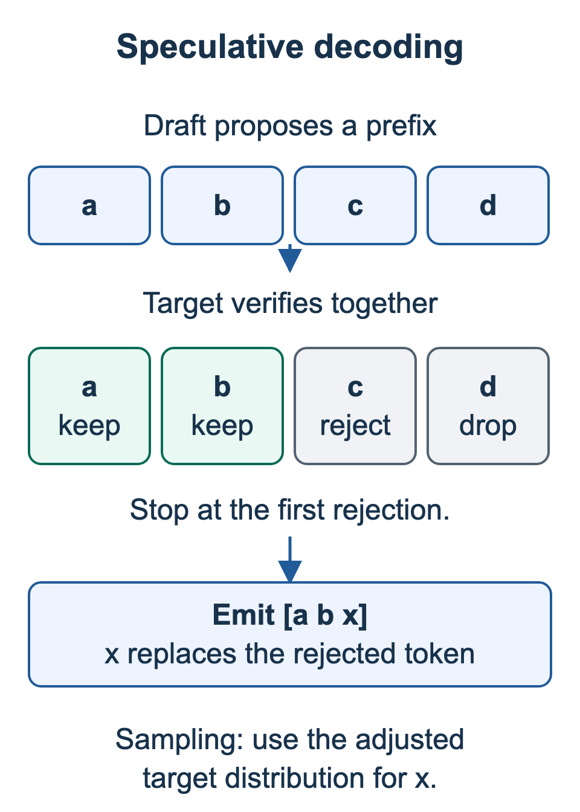

# Speculative decoding — Flashcards
Tags: #flashcards #ai-engineering #inference #speculative-decoding #llm
Verified on: 12 November 2026 — mechanisms and limits against cited articles and documentation; performance to be measured on the target.
<!-- summary: draft and one-pass verification, read damping conditions, lossless acceptance rule, gain according to acceptance rate, choice of k, types of drafts (small model, n-grams, EAGLE, Medusa, MTP), tree verification, when it helps or night, vLLM configuration, costs, acceptance metrics, validation of a deployment, calculation of speculation damping, causation. -->


What is the principle of speculative decoding? <!--anki:735b235457367c524b6a-->
?
An inexpensive **draft** offers multiple tokens; the **target** evaluates these positions together, and then a verification mechanism retains an allowable prefix and produces an additional correction or token.
Here, `a` and `b` are accepted; rejecting `c` emits correction `x` and discards `d`.
The exact linear scheme normally produces at least one token per check, subject to shutdown. This gain does not abolish causality: the draft offers dependencies already known to the checker. The quality of the target remains the reference; the acceptance rule, not the mere presence of a second model, determines the guarantee.



[Diagram reference](https://arxiv.org/abs/2211.17192).

---

Why does checking k tokens cost almost as much as generating one? <!--anki:643b3476537b31506257-->
?
At a small batch, when reading weights dominates, checking several positions together **absorbs a weight reading**. The additional calculation can remain modest compared to this reading, which makes speculation interesting.

This does not imply a free verification: attention, KV, calculation and draft add work. If the GPU is already limited by the high-load calculation, this work can reduce the throughput. Measure the duration of the draft, verification, tokens accepted by pass and goodput, for the lengths and competitors actually targeted.

---

How do I decide to accept a proposed token? <!--anki:4457756f687577352a63-->
?
In **greedy**, compare the choice of the target to the same validated prefix. In exact sampling, a `x` proposal drawn according to `q` is accepted with `min(1, p(x)/q(x))`, where `p` is the target distribution.

Compare a uniform draw to this threshold. At the first rejected proposal, draw a correction in the distribution proportional to `max(p−q, 0)` and abandon the proposed sequence. If all are accepted, draw an additional token according to the target at the prefix completed. The distributions must match the transformations actually applied; confusing raw scores with filtered probabilities invalidates the accuracy argument.

---

Does Speculative Decoding degrade quality? <!--anki:47393e6c375564426d2e-->
?
The exact **speculative sampling**, with correct acceptance/rejection and residual distribution, theoretically preserves the distribution of the target; in Greedy, the verification must preserve its choice.

This property does not automatically cover all so-called "speculative" variants, nor does a target itself quantified against its original model. Check the algorithm and supported modes. Rounding and batch variations can also change individual outputs. Evaluate quality and performance in practice; even seed does not necessarily mean same text, despite a preserved theoretical distribution.

---

What is the speed gain of the specific decoding? <!--anki:657749397926736d7a6f-->
?
In a simplified model with probability of constant conditional acceptance α and k propositions, we produce on average:
```text
E = 1 + α + … + α^k = (1 − α^(k+1)) / (1 − α)
α = 0.8; k = 4 → E = 3.3616 tokens per pass
```
For α = 1, the limit is k + 1. The speedup also depends on the time: `E × standard_decode_time / (draft_time + verification_time + overheads)`. A good acceptance rate is not enough if the draft is too expensive. The actual dependencies and EOS limit this model; measure the gain under load.

---

How to choose the number of tokens proposed (k) in speculative decoding? <!--anki:46282560713f4b67613d-->
?
Increase **k** adds proposals but also the cost of drafting, verification and temporary cache. An early rejection makes the whole sequel useless: marginal performance decreases when long sequels are rarely accepted.

Test several values at the same traffic and compare tokens useful per unit time, not just acceptance rate. An adaptation per load or query category can help if it is supported and validated. There is no universally optimal range: output length, draft method, hardware and concurrency change the compromise. Keep a baseline without speculation and the possibility of deactivation.

---

What are the ways to produce the draft of a specific decoding? <!--anki:507674457b374c6c452c-->
?
A **draft** can come from a small model, a context search, or a module associated with the target.

- **Separate model**: autoregressive proposal with clean cost and cache.
- **Lookup of tokens**: continuations already present in the prompt or a corpus of suffixes.
- **Heads or auxiliary modules**: Medusa, EAGLE, MTP families, with different training dependencies and algorithms.

The draft does not need to be as competent as the target; it must offer often useful continuations quickly enough. The verification method remains decisive to preserve the distribution: not all combinations of heads and acceptance are automatically accurate.

---

When is the quick lookup (n-grams) effective? <!--anki:75357b292e2173597c45-->
?
The **prompt lookup** offers continuations already encountered after a corresponding tokens sequence. It can help when an output takes up the input a lot, for example a code edition or an extraction, but not necessarily on any task with these names.

If the context contains `return total / len(items)` and the output joins `return total /`, the engine can offer `len(items)`. The target still needs to check according to the algorithm selected. There is no second network to load, but search, indexes and buffers consume resources. Measure the rate of really useful recoveries and the cost of their checks.

---

What is tree checking in speculative decoding? <!--anki:7548316562267e3a7176-->
?
A **proposal tree** retains several possible continuations rather than a single string. The target can evaluate its nodes in a pass using a mask that lets each node consult its prefix and ancestors, without mixing incompatible branches.

The choice of the path sent then depends on the verification and sampling algorithm. More branches increase the chances of a useful continuation, but also verified positions, temporary memory and coordination. Simply exploring a tree does not guarantee any time saving or distribution accuracy. Measure the cost per token confirmed and specify the variant used.

---

When Does Speculative Decoding Help and When Does It Night? <!--anki:515b7d72714b55672d64-->
?
- **Help**: small batches and latency-sensitive services, where the GPU is waiting for memory; predictable text (code, JSON, copy); low temperature
- **Night**: **big batches** where the GPU is already saturated in calculation (checking consumes this calculation and lowers the total flow); high temperature or very creative text (low acceptance)

Compare to the normal decode with equal concurrency: a better TPOT for an isolated query can be accompanied by a lower throughput and longer queues in production.

---

What inference metrics does special decoding improve? <!--anki:503836423d712d492f3d-->
?
It mainly targets the **time per token output** and the duration of long responses. It does not remove the prefill from the prompt; draft, compilation or scheduling can also modify the TTFT observed.

With TTFT of 400 MS and 20 ms between tokens, A response from `N` tokens Hard `400 + (N−1) × 20` MS. Divide these intervals by two gives **780 → 590 ms for 20 tokens**, and **10.38 → 5.39 s for 500**. This calculation assumes constant cadence and TTFT unchanged. Live streaming, also measure breaks between groups of tokens and the flow under load.

---

How to enable special decoding in an inference server? <!--anki:676979656b57647b6226-->
?
The main engines support it: vLLM, SGLang, TensorRT-LLM, llama.cpp. In vLLM:
```bash
vllm serve <target-model> --speculative-config '{
  "method": "ngram", "num_speculative_tokens": 4,
  "prompt_lookup_min": 2, "prompt_lookup_max": 5 }'
```
Other values of `method`: `draft_model`, `eagle3`, `mtp`, `suffix`...

The command is an example to adapt to the installed version; check the methods compatible with the model, parallelism and hardware. The n-gram mode offers suites from the context without loading a small model. Measure acceptance rate, latency and throughput: a proposal often rejected can slow down the service.

---

What costs and constraints does the specific decoding impose? <!--anki:4d413c2a2c4a61556e39-->
?
Count **draft calculation**, verification, synchronization, temporary cache and possible additional model. A small separate model has its weight and its state; a lookup uses rather index and buffers, without second neural network.

The common tokens standard space scheme assumes a compatible tokenizer; inter-tokenizer techniques exist but require a specific mechanism. Trained heads must match the target and the mode used. Check constraints of parallelism, quantification and structured generation. Acceptance does not decide on its own: a method that keeps many tokens can consume the capacity needed for other requests.

---

What metrics to follow for the specific decoding? <!--anki:732143772f26244d7852-->
?
Separate **draft acceptance**, **useful tokens issued by verification**, latency and overall capacity. A token correction or bonus counts in useful outputs, without being an accepted proposal.

In the standard linear scheme, out of early shutdown: average emitted length = `1 + accepted proposals / verification passes`. The ratio `accepted / proposed` answers another question. Also follow acceptance by position, drafting time and verification, memory and goodput. The counter names depend on the engine and version; control their definition. EOS, proposals of variable length and output constraints require an explicit count.

---

How do I validate a deployment with special decoding? <!--anki:6c70435e57353c775b6d-->
?
1. **Fix reference**: target, tokenizer, sampling, constraints and hardware; identify if the variant announces an exact check.
2. **Control results**: compare greedy with numerical gap analysis; in sampling, examine relevant distributions and quality with uncertainty.
3. **Test multiple loads**: draft, check, TTFT, stream pauses, goodput and memory, on the same lengths.
4. **Check stops**: EOS, exit limit, rejection and early rejection with cache properly restored.
5. **Decide according to SLO** and maintain a return to normal decode.

Stable evaluation completes algorithmic validation; it does not by itself show that two distributions are identical.

---

Calculation: a draft costs 2 ms for a block, its verification 10 ms and accepts on average three useful tokens. What ideal gain compared to 6 ms by token without speculation? <!--anki:3234653339366662386438313464663039353764653432633838636563643462-->
?
The block costs `2 + 10 = 12 ms`. If “three useful tokens” means **three tokens issued in total**, correction or bonus included:
```text
time = 12/3 = 4 ms/token; acceleration = 6/4 = 1.5×
```
If, on the other hand, there were three accepted proposals **plus** a bonus, four tokens would be issued: `12/4 = 3 ms/token`, or `2×`.

These results assume constant costs, no anticipated termination and comparable conditions. Include draft memory, synchronization and actual load for a deployment decision; one gain per sequence does not guarantee more useful queries per second.

---

Why can the target check multiple positions without knowing the future real tokens? <!--anki:3232636563643463316334383431643862396565303838373464393862383235-->
?
It receives an already explicit **proposed continuation** and calculates conditional distributions under causal mask, as when it treats a known prompt.
```text
position 1: p(a | prefix)
position 2: p(b | prefix, a)
position 3: p(c | prefix, a, b)
```
These calculations can be grouped into a pass on the positions; the layers remain ordered. As long as `a,b` are accepted, their conditioning is suitable. If `b` is rejected, the distribution calculated after `a,b` no longer describes the actual emitted continuation: the following propositions must be discarded: “Parallel” here means scores on known hypotheses, not independent prediction of the future.

---

Calculation: with p=(0.6; 0.3; 0.1) and q=(0.2; 0.3; 0.5) on A,B,C, what probabilities of acceptance? <!--anki:3633616434326637336366643463653661653836346235383533653432363865-->
?
Apply `min(1,p/q)` to each proposal:
```text
A : min(1, 0,6/0,2) = 1
B : min(1, 0,3/0,3) = 1
C : min(1, 0,1/0,5) = 0,2
```
The draft proposes `C` with probability 0.5, but only a fifth of these proposals are accepted. The total accepted mass is `0,2 + 0,3 + 0,1 = 0,6`; the rejected mass is 0.4. The three components are probabilities at the same prefix, after the selected sampling settings. An acceptance equal to one does not mean that this token will be systematically proposed or emitted.

---

Calculation: in the example p=(0.6; 0.3; 0.1), q=(0.2; 0.3; 0.5), what to shoot after a rejection? <!--anki:6263393163343864323865343465396261386237326263623763613564313561-->
?
The **Positive residual mass** is worth:
```text
max(p−q,0) = (0,4 ; 0 ; 0)
after normalization: r = (1; 0; 0)
```
The correction is therefore `A`. By aggregating the accepted proposals `(0,2;0,3;0,1)` and the rejection mass `0,4` redirected to `A`, we find exactly `(0,6;0,3;0,1)`.

This example uses the same prefix and the normalized distributions indicated. It shows why simply firing in `p` after rejection would be wrong: some masses of `p` have already been brought by the accepted tokens. If `p=q`, no rejection occurs theoretically; the residual does not have to be normalized.

---

Why does the residual correction preserve the target distribution in the exact speculative sampling? <!--anki:3266636462356239346462303434383539643535633831363834343436363938-->
?
The probability of sending `x` via an accepted proposal is `q(x) × min(1,p(x)/q(x)) = min(p(x),q(x))` on the draft support.

The missing mass to reach `p(x)` is therefore `max(p(x)−q(x),0)`. The total probability of rejection is the sum of these gaps; draw a standardized correction reinjects them exactly.
```text
mass accepted for x + corrected mass for x
= min(p(x),q(x)) + max(p(x)−q(x),0) = p(x)
```
Applying this reasoning successively to the validated prefixes gives the guarantee of the schema. Rounded and approximate implementations require a separate control; the demonstration assumes the distributions actually used.

---

Why should I remove proposals after a rejection from the KV? <!--anki:3163353664666432396164393461306339663265663264346664366335323739-->
?
The K/V calculated for a proposal belongs to a hypothetical **prefix**. After the first divergence, the sequence no longer corresponds to the tokens actually emitted.

If `a,b` is accepted but `c` is replaced by `x`, the states of `c,d` should not remain as if they were describing `x` and its sequence. Restoring block lengths and tables, and then integrating the correction before the next proposals. The draft and the target must be resynchronized, depending on the method.

---

Why does an acceptance rate of 80% not mean an acceleration of five? <!--anki:6365323832323936386137623438313638353933613235623561313735613838-->
?
The **Ratio of accepted proposals** does not measure the time of the draft or the verification; even when many proposals pass, producing them can be costly.

In the constant conditional acceptance model `α=0,8` and four propositions, the average number emitted is `1+0,8+0,8²+0,8³+0,8⁴ = 3,3616`. If a speculative iteration costs twice a normal step, the ideal gain is only `3,3616/2 ≈ 1,68`. This model ignores EOS and real dependencies. Do not directly deduce `α` from a counter whose denominator includes propositions never reached after rejection.

---

What to check before claiming that a variant of speculative decoding is lossless? <!--anki:3766663732336130383630323437373838633361666266373635386232306638-->
?
Identify **The exact verification algorithm**, its settings and its reference target. Some methods voluntarily release verification to save time; the name "speculative" does not guarantee the preservation of distribution.

Compare the same target, tokenizer, filters and constraints, then test greedy and sampling according to their protocol. The current documentation of vLLM distinguishes in particular the standard rejection of approximate variants like FLy. An unchanged business evaluation is not a mathematical proof of distribution identity; conversely, different texts for the same seed do not refute the theoretical guarantee alone. Measure quality, relevant distributions and numerical deviations.

---

Why can speculative tokens arrive in small groups in a stream? <!--anki:3662343236653065666364663462323138326463363730306564393633346230-->
?
The **validation is done by iteration**: several tokens become publishable together after the same verification. The client can receive a group and then wait for the next iteration.

A better average time per token therefore does not guarantee a perfectly regular rate. Measure the reception intervals, group sizes and visible breaks, distinguishing engine grouping and network buffering. For voice or interactive display, a long break between two groups can remain troublesome despite a good average rate. The rejected tokens should not be displayed as confirmed text before correction.

---

Calculation: a draft proposes 3 tokens, each accepted with constant conditional probability 0.8; the procedure also issues a target token after rejection or full acceptance. What average number of tokens issued per cycle? <!--anki:3836646662373061396236313466613138613031353765616331366635666330-->
?
The expectation is **1 + 0.8 + 0.8² + 0.8³ = 2.952 tokens**. Each term corresponds to the probability of reaching an additional position.

This assumes no EOS and no output limit in the block. The speed factor is not automatically 2.952: you have to divide by the cost of the draft, the verification and the management of the cache, and then compare to the reference decode.

---

Why should a server not publish a whole speculative block before validation? <!--anki:6231396365323963363534383463616139306266633165623535313165363136-->
?
The tokens in the draft can be **rejected or after an accepted EOS**. Sending them to the client would reveal a text that the final generation should not contain.

Publish only the validated prefix, meet the shutdown conditions and remove the rejected states. Test rejection to the first token, EOS in the middle and output budget almost exhausted. Streaming must follow the validated target sequence, even if the internal calculation works in groups.

---

## Scenarios

Scenario: you activate the special decoding on your assistant. In test to a user, the generation is twice as fast; in production at peak hours, the total throughput decreases. Why? <!--anki:72653f2439376372473a-->
?
1. **Compare to equal traffic**: same lengths, quality and concurrency; measure useful throughput rather than only tokens/s.
2. **Profile Phases**: A low-batch draft and check can consume extra computation at peak.
3. **Examine memory**: Weight and KV of draft can reduce the concurrency available to the target.
4. **Test multiple ks and activation policies**, if the engine allows, including visible queues and pauses.
5. **Choose according to the joint SLO**: latency, throughput and cost.

**Trap**: To conclude in advance that any low load is limited by memory, or that any high load must disable speculation.

---

Scenario: your acceptance rate caps to 45% with a small draft model, and the gain is disappointing. What options? <!--anki:4e214843397e5f573d46-->
?
1. **Check the metric**: proposals counted, positions reached, corrections and possible early stops.
2. **Segment the results** according to inputs, outputs, length and sampling, without assuming that a category guarantees a high rate.
3. **Measure the cost of the draft** and the actual length confirmed by verification.
4. **Compare other compatible proposals**: better aligned model, dedicated modules or lookup when repetitions exist.
5. **Set k or disable by road** based on measured time and quality.

**Trap**: Increase the number of proposals to compensate for early poor acceptance; the rejected sequel can add work without any useful output.

---

Scenario: a quality manager is concerned that the specific decoding changes the answers of the model. How do you reassure him, supporting evidence? <!--anki:6f23684542583862703a-->
?
1. **Identify variant and reference**: Exact standard rejection and released verification do not offer the same guarantee.
2. **Explain the residual correction**, which restores the missing probability mass in the exact scheme.
3. **Tester greedy and sampling** with same target and parameters, distinguishing numerical deviations, bug and normal variance.
4. **Cover limit cases**: EOS, JSON constrained, rejects, cache and exit limit.
5. **Monitor quality and performance** by segment after deployment.

**Trap**: announce a guarantee for all so-called speculative techniques, or present some identical answers as a general proof of distribution conservation.

---

## Sources

- [vLLM — Speculative Decoding and Digital Reproducibility Limits](https://docs.vllm.ai/en/latest/features/speculative_decoding/index.html)

- [Leviathan et al. — Fast Inference from Transformers via Speculative Decoding](https://proceedings.mlr.press/v202/leviathan23a.html) — targeted review of 12 November 2026: acceptance, residual correction and length expectancy.

- [Chen et al. — Accelerating Large Language Model Decoding with Speculative Sampling](https://arxiv.org/abs/2302.01318) — Targeted Review of 12 November 2026: Distribution Retention and Digital Limits.

- [vLLM — Speculative decoding configuration and guarantees](https://docs.vllm.ai/en/latest/features/speculative_decoding/) — targeted review of 12 November 2026: exact diagram, approximate variants and n-gram command.

- [vLLM — metric of acceptance per request](https://docs.vllm.ai/en/latest/features/speculative_decoding/acceptance_metrics/) — targeted review of 12 November 2026: accepted proposals, tokens bonus and length issued.

- Supplement of 14 November 2026 — Expectancy of tokens validated by cycle: [Leviathan et al — Speculative Decoding](https://arxiv.org/abs/2211.17192).

## Connections
- [[62-inference-optimizations|Inference optimizations]] — prefill, decode and memory bandwidth
- [[65-probabilities-sampling|Probability & sampling]] — why distribution is preserved
- [[64-inference-metrics-slo|Metrics & SLO]] — effect on TPOT and TTFT
- [[11-llm-inference-servers|Inference Servers]] — vLLM, SGLang, TensorRT-LLM
- [[114-reproducibility-variance|Reproducibility & variance]] — digital deviations
- [[68-quantization|Quantization]] — the other lever to accelerate the decode
- [[93-monitoring-inference|Monitoring of inference]] — follow the acceptance in production
- [[61-kv-cache-attention|KV cache]] — memory that limits concurrency
- [[69-roofline-prefill-decode|Roofline & Disaggregation]] — which limits each phase of the inference
- [[60-013-prefill-decode-step-by-step|Prefill & decode step by step]] — track calculated positions, cache and delays
- [[60-014-inference-parity-validation|Inference parity]] — parity tests of an inference deployment
- [[00-moc-ai-engineering|MOC AI Engineering]]
