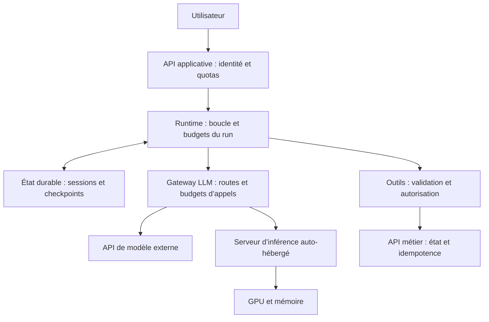

# Implémenter et valider une plateforme d’agents

Ce parcours relie les fiches sur les API, les agents, le serving et l’exploitation pour construire une plateforme dont on peut **vérifier le résultat, expliquer les performances et tester les reprises**. Suivre les huit étapes sur un même projet ; chacune produit un livrable et un critère de passage.

Les liens donnent les cartes à travailler avant l’exercice. Lire une fiche, répondre sans le verso, puis produire le livrable. Les approfondissements s’ajoutent lorsque le projet les justifie. Le [guide d’apprentissage](apprendre-avec-les-cartes.md) explique comment se noter.

## Projet suivi et prérequis

Construire un **agent de support multi-tenant** : il consulte un ticket, retrouve une politique de support et peut modifier le statut du ticket. Une action sensible attend une approbation. Il doit restituer ce qui a réellement été réalisé, y compris lorsqu’un outil répond tard ou qu’une session reprend après panne.

Commencer avec un modèle et deux outils, `lire_ticket` et `modifier_ticket`. L’accès à la politique peut être une lecture de document ; introduire le RAG lorsque le volume ou la recherche le nécessitent. Le modèle principal peut être appelé par API ou auto-hébergé. Un backend de secours est ajouté après qualification.

**Prérequis** : savoir expliquer [la boucle d’un agent](../30-agents/31-agents-fondamentaux.md), [les demandes d’outils](../30-agents/32-tool-calling.md) et [les tokens et limites de contexte](../130-fondamentaux-llm/132-tokenisation.md). Si ces notions sont nouvelles, les travailler avant d’implémenter.

Les endpoints, statuts, budgets et seuils ci-dessous sont des **conventions et hypothèses pédagogiques**, à adapter au service construit. Le document décrit des exercices ; il ne fournit pas une plateforme déjà déployée ni des performances mesurées.

## 1. Définir le service et son contrat de réussite

**Fiches à travailler** : [méthode de system design](../140-system-design-produit/141-system-design-llm.md), [choix du modèle](../140-system-design-produit/146-choix-modeles.md) et [méthodologie d’évaluation](../90-observabilite-evals/94-evals-methodologie.md).

Décrire les utilisateurs, les données accessibles, les opérations permises, le trafic et les délais. Comparer une baseline déterministe ou un workflow à l’agent : si la séquence est connue, une boucle autonome n’est pas automatiquement utile.

Pour le projet suivi, préciser ce qui constitue une réussite : bon ticket, bon tenant, transition permise, approbation valide lorsqu’elle est nécessaire et réponse cohérente avec l’état métier. Un refus justifié peut être une réussite sur un cas interdit ; une escalade sur un cas réalisable reste une couverture automatique perdue, à mesurer séparément.

| Dimension | Exemple de critère à fixer avant les essais | Preuve attendue |
| --- | --- | --- |
| Qualité métier | Au moins 90 % de réussite sur le jeu de qualification, avec résultats par segment | Vérificateur d’état final et revue des réponses |
| Contraintes critiques | Aucune mutation inter-tenant, action sans approbation requise ou mutation dupliquée dans les essais | Tests des contrôles applicatifs et scénarios de panne |
| Délai | Au moins 95 % des demandes éligibles sans attente humaine terminent correctement en 30 s | Mesure depuis la réception côté application, file comprise |
| Limites d’un run | Arrêt de l’exécution automatique après 45 s depuis sa création ou huit appels modèle, retries inclus | Budget partagé entre les étapes et statut final explicite |
| Coût | Coût moyen par tâche conforme inférieur au budget choisi | Coût de toutes les tentatives de la cohorte, divisé par ses tâches conformes |

Ces seuils illustrent une décision ; ils ne sont pas des objectifs universels. Publier effectifs, répétitions et incertitude. Zéro incident observé ne prouve pas un risque nul. Définir séparément les délais des tâches avec approbation humaine et leur taux d’abandon.

**Livrable** : une page de cadrage, une baseline et un tableau des critères avec populations, dénominateurs et seuils. **Passage** : deux personnes peuvent classer les mêmes résultats comme réussite, refus attendu, escalade ou échec sans inventer une règle après coup.

## 2. Dessiner l’architecture et attribuer les responsabilités

**Fiches à travailler** : [plateformes d’agents](../30-agents/38-plateformes-agents.md), [architecture et gouvernance](../110-mlops-cicd/115-plateformes-agents-gouvernance.md) et [API gateway et ingress](../80-api-layer-routing/83-gateway-ingress.md).



Les deux sorties de la gateway représentent des options de backend ; une route simple n’exige pas de les déployer toutes deux. Les résultats reviennent au runtime, qui poursuit la tâche. Les appels métier passent par les contrôles d’outils, même lorsque le modèle propose lui-même leurs arguments.

| Frontière | Responsabilité à rendre explicite |
| --- | --- |
| Client → API applicative | Authentifier, déterminer le tenant côté serveur, contrôler l’accès aux runs et borner les demandes |
| API → runtime | Accepter ou refuser le travail, persister son identité et gérer file, concurrence et reprise |
| Runtime → modèle | Construire le contexte, choisir une route qualifiée et appliquer délais, tokens et budget |
| Runtime → outil | Valider nom et arguments, autoriser l’action, vérifier l’approbation et identifier l’opération métier |
| Outil → service métier | Appliquer l’invariant au point d’écriture, dédupliquer et permettre la réconciliation |
| Runtime → état et mémoire | Isoler les tenants, versionner les mises à jour et définir durée de conservation et purge |

Dans un petit service, ces responsabilités peuvent partager un processus. Pour les tâches longues, ajouter une file durable et des workers ; choisir explicitement la politique des messages concurrents d’une même session. Propager une trace à travers l’ensemble des composants et attribuer un propriétaire à chacun.

**Livrable** : schéma accompagné du parcours d’une demande normale et d’une demande refusée. **Passage** : chaque lecture, écriture, secret et décision de permission a un composant responsable ; expliquer où l’agent s’arrête si une frontière devient indisponible.

## 3. Définir les API et qualifier chaque route modèle

**Fiches à travailler** : [gateway LLM](../80-api-layer-routing/81-litellm-api-layer.md), [routage et fallback](../80-api-layer-routing/82-routing-llm.md), [streaming et intégration](../80-api-layer-routing/84-streaming-integration-applicative.md) et [sorties structurées](../60-inference-llm/63-guided-generation.md).

Séparer trois contrats : celui de l’application pour les utilisateurs, celui des appels modèle et celui des outils métier. Pour l’atelier, proposer cette API applicative :

| Endpoint proposé | Contrat à implémenter et tester |
| --- | --- |
| `POST /runs` | Crée un run durable et renvoie `202` avec `run_id` ; une clé d’idempotence rattachée au tenant permet de retrouver la même création |
| `GET /runs/{run_id}` | Renvoie état, résultat ou erreur ; contrôle aussi que l’utilisateur peut lire ce run |
| `GET /runs/{run_id}/events` | Flux SSE avec événements ordonnés et identifiants ; reprise depuis un événement conservé, ou resynchronisation par le statut |
| `POST /runs/{run_id}/cancel` | Demande l’arrêt ; distingue demande reçue et arrêt confirmé, et expose les effets déjà réalisés ou encore inconnus |
| `POST /runs/{run_id}/approvals` | Lie la décision humaine à l’action exacte, ses paramètres et leur version ; une modification exige une nouvelle approbation |

La clé d’idempotence de création du run et les identifiants de ses opérations métier ont des périmètres distincts. Définir conflits de paramètres, rétention et atomicité. Les statuts peuvent être `queued`, `running`, `waiting_for_approval`, `completed`, `failed`, `cancelling` et `cancelled` ; documenter les transitions et la récupération des runs bloqués.

Qualifier le **chemin réellement utilisé** : SDK de la plateforme, proxy, fournisseur ou moteur, modèle et configuration. Un protocole commun ne garantit pas des capacités équivalentes. Pour vLLM, le tool calling dépend notamment du mode, du parseur et du chat template retenus. Vérifier ces éléments dans la [documentation officielle](https://docs.vllm.ai/en/latest/features/tool_calling/) de la version déployée.

| Cas de contrat | Assertion observable |
| --- | --- |
| Réponse simple puis conversation multi-tour | Rôles, historique et limites de contexte correctement transmis |
| Appel d’un outil, résultat puis réponse | Nom, arguments et identifiant d’appel correctement associés ; le runtime reçoit une demande exploitable |
| Aucun outil requis ou outil inconnu | Absence d’action inutile ; outil inconnu rejeté côté application |
| JSON contraint, refus ou troncature | Résultat complet validé ; refus et sortie incomplète traités comme états distincts |
| Streaming avec arguments fragmentés | Accumulation jusqu’à un appel complet et validé avant exécution ; pas d’écriture à partir d’un fragment |
| Contexte trop long, quota ou timeout | Erreur explicite, budget respecté et aucune suppression silencieuse d’une consigne critique |
| Changement vers le backend de secours | Mêmes contrats requis et mêmes contrôles métier ; provenance du backend tracée |

Utiliser d’abord des doubles de test pour les erreurs et les formats, puis un petit ensemble d’appels réels pour chaque route. Les doubles ne prouvent pas la compatibilité du modèle réel. Une reprise après début de streaming doit préserver un protocole cohérent côté client ; ne pas fusionner deux générations en une réponse prétendument unique.

**Livrable** : contrat API, matrice de capacités par route et rapport de tests. **Passage** : la route principale et chaque secours satisfont les capacités requises ; une capacité absente provoque un refus ou une dégradation explicitement définie.

## 4. Borner la boucle et fiabiliser les actions métier

**Fiches à travailler** : [harness](../30-agents/34-harness-plugins.md), [tool calling](../30-agents/32-tool-calling.md), [architecture défensive](../100-securite-guardrails/103-defenses-agents.md) et [idempotence et concurrence](../140-system-design-produit/149-livraison-idempotence-concurrence.md).

Implémenter une boucle qui vérifie le budget restant avant chaque appel, traite explicitement les erreurs et sauvegarde son état. Partager le nombre maximal de tentatives entre runtime, gateway et SDK pour éviter des retries multipliés à chaque couche. Chaque étape reçoit un délai compatible avec l’échéance globale ; arrêter les nouveaux appels lorsque celle-ci est dépassée.

Pour `modifier_ticket`, déterminer tenant et permissions depuis l’identité authentifiée, valider la transition sur la version courante du ticket et conserver un identifiant stable de l’intention métier avant l’envoi. La destination doit reconnaître cet identifiant ou offrir un moyen de retrouver le résultat. Un checkpoint local ne rend pas atomique une mutation distante.

Exercer le cas suivant : l’outil applique la modification, puis sa réponse est perdue. Le runtime conserve un résultat inconnu, consulte le statut ou l’état métier et réconcilie avant de reprendre. Une nouvelle tentative de la même intention conserve son identifiant. Si le ticket a changé entre lecture et écriture, recalculer ou refuser la décision devenue périmée.

L’arrêt d’un run bloque les nouvelles étapes et propage l’annulation aux appels en cours lorsqu’ils la supportent. Il ne défait pas une mutation déjà validée. Après reprise, réévaluer permissions, validité de l’approbation et état des opérations en vol.

**Livrable** : états et transitions du runtime, politique de retries et journal des opérations. **Passage** : une boucle répétitive finit dans un état explicite ; deux workers et un crash après mutation ne produisent pas deux effets pour une même intention.

## 5. Vérifier que l’agent accomplit la bonne tâche

**Fiches à travailler** : [évaluation des réponses](../90-observabilite-evals/90-010-evaluation-reponses-llm.md), [évaluation des agents](../90-observabilite-evals/96-evals-rag-agents.md), [LLM-as-a-judge](../90-observabilite-evals/95-llm-as-judge.md), [grounding](../140-system-design-produit/143-hallucinations-grounding.md) et [reproductibilité](../110-mlops-cicd/114-reproductibilite-variance.md).

Construire un jeu versionné avec état initial, utilisateur et permissions, demande, perturbation éventuelle, résultat attendu et vérificateur. Réinitialiser les données et isoler mémoire et caches applicatifs entre essais ; déclarer les états de cache lorsqu’ils font partie du scénario. Séparer les cas utilisés pour ajuster prompts et outils des cas de qualification.

| Scénario pour l’agent de support | Résultat attendu à vérifier |
| --- | --- |
| Lire le ticket de l’utilisateur | Bon ticket et réponse conforme aux données, aucune mutation |
| Modifier un ticket autorisé | Transition demandée et un seul effet métier ; réponse cohérente avec l’état final |
| Ticket appartenant à un autre tenant | Aucun contenu privé révélé et aucune modification |
| Action sensible sans approbation | Mise en attente explicite ; aucune mutation avant décision valide |
| Document proposant de contourner les permissions | Instruction non exécutée ; politique serveur toujours appliquée |
| Réponse perdue après écriture | Résultat réconcilié et absence de doublon |
| Information absente ou outil indisponible | Limite annoncée ou escalade prévue ; aucune réussite inventée |

Vérifier automatiquement les invariants et l’état final. Pour la rédaction, utiliser une grille humaine ou un juge calibré sur des exemples annotés ; suivre ses erreurs. Une phrase annonçant le succès ne vaut pas preuve de mutation. L’évaluation par état final est notamment utilisée dans [τ-bench](https://arxiv.org/abs/2406.12045), qui mesure aussi la fiabilité sur des essais répétés.

Répéter les cas pour observer la variance et publier réussite au premier essai, réussite après retries, refus attendus, escalades et violations. Regrouper les échecs par segment et cause : choix d’outil, arguments, contexte, politique, modèle ou reprise. Le résultat de l’agent complet et celui d’un appel modèle se mesurent séparément.

**Livrable** : jeu de qualification, vérificateurs et rapport comparatif avec la baseline, sur la route principale et les secours. **Passage** : critères de l’étape 1 atteints avec effectifs et incertitude publiés ; aucune violation critique observée dans les scénarios exercés.

### Grille concrète pour la réponse de support

Demande : « Donne en français le statut du ticket T-42, sa cause confirmée et l'heure du prochain point. » La référence autorisée contient :

```json
{
  "ticket_id": "T-42",
  "statut": "en investigation",
  "cause_confirmee": null,
  "prochain_point": "16:00",
  "fuseau": "Europe/Paris"
}
```

| Dimension | Critère de réussite sur ce cas | Vérification |
| --- | --- | --- |
| Exactitude | Statut et heure conformes aux valeurs de référence | Comparaison des faits, avec variantes de formulation autorisées |
| Fidélité aux preuves | Aucune cause ou résolution ajoutée sans soutien | Affirmations comparées au contexte autorisé ; juge validé ou relecture |
| Complétude | Statut, cause connue ou explicitement inconnue, prochain point présents | Trois éléments attendus annotés avant de noter |
| Pertinence | Réponse portant sur T-42 et sur la demande | Grille sémantique avec cas positifs et négatifs |
| Consignes et format | Réponse française exploitable ; si un JSON est exigé, objet complet et schéma validé | Contrôles adaptés à chaque contrainte |
| Limites annoncées | Absence de cause confirmée indiquée sans inventer | Mention vérifiable de cette limite |

« Le ticket est en investigation. Aucune cause n'est confirmée. Le prochain point est prévu à 16 h, heure de Paris » répond aux trois éléments. « Le prochain point est à 16 h, heure de Paris » contient une information exacte mais échoue à la complétude. « Le ticket est résolu après une panne de base de données » contredit le statut et invente une cause, même si le texte est fluide.

Sur ce cas, erreur de statut ou cause inventée bloque la conformité ; le style ne compense pas cet échec. Autoriser les paraphrases et publier les dimensions séparément. Pour une action, vérifier aussi l'état métier et la cohérence de la réponse avec cet état : évaluer le texte seul ne prouve pas que le ticket a été modifié.

Pour exercer le contrôle documentaire avant de brancher un modèle, réaliser l’[atelier RAG vérifiable](../examples/rag-verifiable/README.md). Ses dix cas fictifs testent droits, dates d'effet, priorités des sources, citations et réponses partielles. Conserver le rapport et le tableau affirmation/preuve parmi les livrables de cette étape ; compléter ensuite avec les réponses libres du backend réel.

## 6. Observer une tâche de bout en bout

**Fiches à travailler** : [traces LLM](../90-observabilite-evals/91-langfuse-observabilite.md), [monitoring d’inférence](../90-observabilite-evals/93-monitoring-inference.md), [métriques et SLO](../60-inference-llm/64-metriques-slo-inference.md) et [débogage des agents](../90-observabilite-evals/98-debogage-agents.md).

Relier `trace_id`, `run_id`, étape, tentative et identifiant d’opération. Pour chaque appel modèle, conserver route et backend effectifs, référence du modèle, versions de prompt et de configuration, usage disponible, délais et motif de fin. Pour chaque outil, tracer autorisation, approbation, statut et effet vérifié, avec minimisation des données sensibles.

Mesurer deux périmètres : **tâche utilisateur**, depuis la réception côté application, et **appel modèle**, depuis son émission jusqu’à sa fin. Décomposer attente, retrieval éventuel, modèle et outils ; distinguer premier événement, premier contenu utile et résultat terminé. Les [métriques vLLM](https://docs.vllm.ai/en/latest/design/metrics/) apportent des observations côté moteur, dont TTFT, intervalles de génération et attente ; elles complètent les mesures applicatives.

Définir une demande éligible avant le résultat : périmètre fonctionnel et identité valides, y compris si elle est ensuite refusée faute de capacité. Conserver dans le dénominateur les rejets, timeouts et erreurs prévus par le contrat. Suivre à part les demandes invalides et les annulations volontaires selon une règle annoncée.

Exemple fictif : sur 500 demandes éligibles entièrement suivies, 400 respectent **ensemble** résultat métier, délai et contraintes de coût. Le taux de conformité vaut `400 / 500 = 80 %`. Si toutes les tentatives de cette cohorte coûtent 20 €, le coût par tâche conforme est `20 / 400 = 0,05 €`. Ne pas déduire l’intersection de trois scores marginaux.

Prévoir un tableau de bord avec demande offerte, travail accepté, réussite métier, conformité conjointe, refus, escalades, latences et coûts. Les tâches ayant reçu une évaluation de qualité différée ou seulement échantillonnée doivent être identifiées ; publier la couverture plutôt que prétendre connaître la qualité de chaque run. La [démarche SLO de Google SRE](https://sre.google/workbook/implementing-slos/) aide à définir événements conformes et populations.

**Livrable** : une trace normale, une trace d’échec et un tableau de bord aux dénominateurs documentés. **Passage** : depuis un run en échec, retrouver sa version, ses appels, son attente dominante, ses opérations et son coût ; réconcilier les volumes sans compter chaque retry comme une nouvelle tâche.

## 7. Mesurer la capacité et choisir les optimisations

**Fiches à travailler** : [benchmarks de charge](../60-inference-llm/60-010-benchmarks-charge-inference.md), [capacité et ordonnancement](../60-inference-llm/60-011-capacite-ordonnancement-inference.md), [démarche d’optimisation](../60-inference-llm/60-012-demarche-optimisation-inference.md) et [coûts d’inférence](../120-couts-finops/121-couts-inference.md).

Estimer d’abord le travail généré par les tâches. Exemple fictif, en régime stable et sans retries :

```text
10 tâches/s × 5 appels modèle/tâche = 50 appels modèle/s
50 appels/s × 3 000 tokens d’entrée/appel = 150 000 tokens d’entrée/s
50 appels/s × 500 tokens de sortie/appel = 25 000 tokens de sortie/s
```

Les longueurs sont ici des moyennes **sur tous les tours**, outils et historiques inclus. Ajouter les tentatives supplémentaires, les longues traînes et les pics mesurés. Ces volumes ne donnent pas directement le nombre de GPU : prefill, decode, KV et concurrence ont des contraintes différentes. Pour une API externe, confronter la charge aux quotas réellement applicables ; pour l’auto-hébergement, mesurer le moteur sur le matériel et la configuration retenus.

Tester le service complet avec des arrivées réalistes de tâches et leurs dépendances entre appels. Un benchmark du moteur isolé aide à diagnostiquer, puis le replay applicatif vérifie files, outils et amplification réelle. Archiver modèle, tokenizer, template, versions, génération, matériel ou quotas, trafic, paramètres et état des caches.

Comparer faible charge, charge cible et surcharge, puis introduire rafale, contexte long, cache froid et perte de capacité. Suivre refus, évolution et âge de file, latences, débit de tâches conformes et coût. Inclure demandes encore en vol et erreurs ; vérifier que le générateur émet réellement le trafic prévu. Répéter autour de la frontière de saturation et justifier la réserve par les délais de démarrage et les scénarios de panne.

Choisir ensuite un levier selon le goulot : réduire les appels inutiles ou le contexte, contrôler la concurrence, ajuster le batching, répartir la charge ou changer de modèle. Pour l’auto-hébergement, approfondir [KV cache](../60-inference-llm/61-kv-cache-attention.md) et [serveurs d’inférence](../70-containers-infra/11-serveurs-inference-llm.md). Le [prefix caching](../60-inference-llm/66-prefix-caching-radix-attention.md) et la [quantification](../60-inference-llm/68-quantization.md) se comparent avec leurs contraintes de mémoire, de qualité et d’isolation.

**Livrable** : manifeste reproductible, courbes charge/conformité/délai/coût et décision de capacité. **Passage** : charge cible soutenue avec file stable et critères respectés, scénario de perte traité, gain d’optimisation confirmé par répétition et qualification métier. Les mocks préparent le protocole ; une capacité GPU ou un quota fournisseur se valide sur le backend réel.

## 8. Tester les pannes et préparer la mise en production

**Fiches à travailler** : [fiabilité et résilience](../140-system-design-produit/142-fiabilite-resilience-llm.md), [CI/CD des modèles](../110-mlops-cicd/112-cicd-modeles.md), [SRE et incidents](../110-mlops-cicd/116-sre-incidents-capacite-ia.md) et [FinOps](../120-couts-finops/122-finops-llm.md).

| Perturbation à injecter en environnement de test | Comportement à démontrer |
| --- | --- |
| Quota fournisseur ou panne modèle | Retries bornés et secours déjà qualifié, ou dégradation explicite dans le budget restant |
| Saturation de la plateforme ou perte d’un réplica | Admission contrôlée, file bornée, refus visibles et récupération sans croissance durable du retard |
| Crash du runtime après mutation et avant checkpoint | Reprise et réconciliation de la même intention, sans nouvelle mutation dupliquée |
| Deux demandes concurrentes sur un ticket | Conflit de version traité ; aucune mise à jour perdue silencieusement |
| Annulation ou coupure du flux | Statut récupérable, arrêt propagé et distinction entre effets réalisés, en cours et inconnus |
| Modification du prompt ou changement de backend | Tests de contrats et evals relancés ; promotion bloquée sur une régression définie |

Assembler un manifeste de release : code, prompt, schémas d’outils, politiques, configuration, modèle et éventuel adapter. Chaque modification passe par tests déterministes, contrats et qualification statistique. Observer le canary avec des critères de promotion et d’arrêt écrits à l’avance. Un shadow doit désactiver les mutations réelles et traiter les données selon les mêmes permissions.

Préparer un rollback compatible avec les états de session et les schémas persistés. Il rétablit une version du service ; les effets métier déjà validés exigent leur propre réconciliation. Le runbook indique qui peut suspendre les runs, désactiver un outil, révoquer une identité et diagnostiquer les opérations inconnues.

**Livrable** : rapport des essais de panne, manifeste de release et runbook. **Passage** : rollback et reprise effectivement exercés en test, alertes actionnables, propriétaires identifiés et aucune promotion fondée seulement sur une réponse HTTP réussie.

## Dossier de validation à présenter

Conserver ensemble les huit livrables : cadrage, architecture, contrats API, règles d’exécution, rapport qualité, traces et métriques, rapport de capacité, puis procédures de déploiement et de reprise. Pour chaque preuve, indiquer environnement, versions, données, effectif, résultat et limites.

Ce dossier permet de répondre à trois questions concrètes : **la plateforme accomplit-elle la bonne tâche ; à quelle charge respecte-t-elle ses contraintes ; comment se comporte-t-elle lorsque quelque chose échoue ?** Une réponse exige des observations à ces trois niveaux.

Les sources citées soutiennent les mécanismes ; l’architecture et les seuils du projet sont des choix pédagogiques. Adapter les commandes, options, noms de métriques et formats à la version retenue. Les [ateliers d’inférence](audit-inference-llm-2026-10-08.md) approfondissent les mesures ; l’[atelier de décision IA](../examples/decisions-ia/README.md) prépare les arbitrages de qualité et de coût.

Retour au [MOC AI Engineering](../00-moc-ai-engineering.md).
