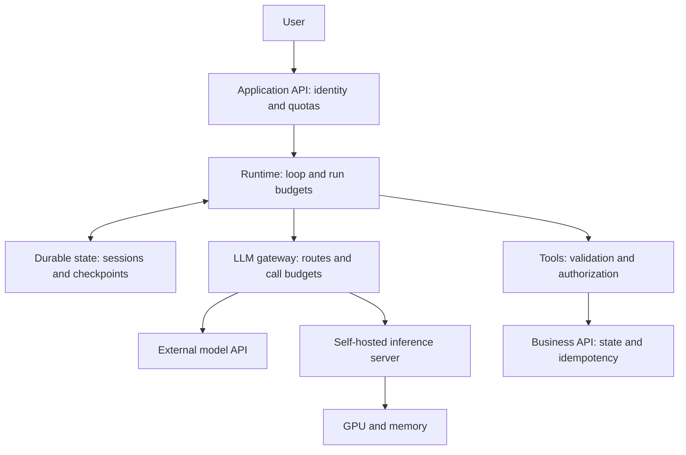

# Implement and validate an agent platform

This course connects the topics on the API, the agents, the serving and the operation to build a platform whose result can be **checked, explain the performance and test the covers**. Follow the eight steps on the same project; each produces a deliverable and a criterion of passage.

The links give the cards to work before the exercise. Read a sheet, answer without the back, then produce the deliverable. Further details are added when the project justifies them. The [Learning Guide](learning-with-flashcards.md) explains how to rate.

## Project monitoring and prerequisites

Build a **multi-tenant support agent**: it consults a ticket, finds a support policy and can change the status of the ticket. A sensitive action awaits an approval. It must return what has actually been done, including when a tool responds late or a session resumes after failure.

Start with a model and two tools, `lire_ticket` and `modifier_ticket`. Access to the policy can be a document read; introduce the RAG when the volume or search requires it. The main model can be called by API or self-hosted. A backup backend is added after qualification.

**Prerequisites**: Know how to explain [The loop of an agent](../30-agents/31-agent-fundamentals.md), [Requests for tools](../30-agents/32-tool-calling.md) and [Tokens and Context Limits](../130-llm-fundamentals/132-tokenization.md). If these concepts are new, work on them before implementing.

The endpoints, statuses, budgets and thresholds below are **conventions and pedagogical hypotheses**, to be adapted to the service built. The document describes exercises; it does not provide a platform already deployed or measured performance.

## 1. Define the service and its success contract

**Files to work**: [System Design Method](../140-system-design-product/141-system-design-llm.md), [choice of model](../140-system-design-product/146-model-selection.md) and [Evaluation methodology](../90-observability-evals/94-evals-methodology.md).

Comparing a deterministic baseline or workflow to the agent: if the sequence is known, a stand-alone loop is not automatically useful.

For the monitored project, specify what constitutes a success: good ticket, good hold, transition allowed, valid approval when it is necessary and response consistent with the business state. A justified refusal can be a success on a prohibited case; an escalation on a feasible case remains an automatic coverage lost, to be measured separately.

| Dimension | Example of criteria to be set before testing | Expected evidence |
| --- | --- | --- |
| Business quality | At least 90% of success on the qualifying game, with results per segment | Final status checker and review of responses |
| Critical constraints | No inter-tenant mutation, action without required approval, or duplicate mutation in trials | Tests of application controls and failure scenarios |
| Time limit | At least 95% eligible applications without human expectation finish correctly in 30 s | Measurement from reception on the application side, including queue |
| Limits of a Run | Stop automatic execution after 45 s since its creation or eight model calls, including retrievals | Budget shared between stages and explicit final status |
| Cost | Average cost per compliant task below the chosen budget | Cost of all cohort attempts, divided by conforming tasks |

These thresholds exemplify a decision; they are not universal goals. Publishing actuality, repetition and uncertainty. Zero observed incidents does not prove zero risk. Separately define the deadlines of tasks with human approval and their abandonment rate.

**Livable**: a framing page, a baseline and a table of criteria with populations, denominators and thresholds. **Passage**: two people can classify the same results as success, expected refusal, escalation or failure without inventing a rule after the fact.

## 2. Draw architecture and assign responsibilities

**Files to work**: [Platforms of Agents](../30-agents/38-agent-platforms.md), [Architecture and Governance](../110-mlops-cicd/115-agent-platforms-governance.md) and [API gateway and ingress](../80-api-layer-routing/83-gateway-ingress.md).



The two exits of the gateway represent backend options; a single route does not require both of them to be deployed. The results go back to the runtime, which continues the task. Business calls go through the tool controls, even when the model itself offers their arguments.

| Border | Responsibility to be made explicit |
| --- | --- |
| Client → API applicative | Authenticate, determine the server-side hold, control access to runs, and limit requests |
| API → runtime | Accept or refuse work, persist identity and manage file, concurrency and recovery |
| Runtime → model | Build context, choose a qualified route and apply deadlines, tokens and budget |
| Runtime → tool | Validate name and arguments, authorize action, verify approval, and identify business operation |
| → Business Service Tool | Apply the invariant to the writing point, deduplicate and allow reconciliation |
| Runtime → state and memory | Isolate tenants, release updates, and define shelf life and purge |

In a small service, these responsibilities can share a process. For long tasks, add a durable queue and workers; explicitly choose the policy of competing messages of the same session. Spread a trace through all the components and assign an owner to each.

**Deliverable** : diagram accompanied by the route of a normal application and a refused application. **Passage** Every read, Writing, secret and permission decision has a responsible component; Explain where the agent stops if a border becomes unavailable.

## 3. Define the API and qualify each model route

**Files to work**: [gateway LLM](../80-api-layer-routing/81-litellm-api-layer.md), [Routing and Fallback](../80-api-layer-routing/82-routing-llm.md), [Streaming and integration](../80-api-layer-routing/84-streaming-application-integration.md) and [Structured Outputs](../60-llm-inference/63-guided-generation.md).

Separate three contracts: that of the application for users, that of model calls and that of business tools. For the workshop, propose this API application:

| Proposed endpoint | Contract to be implemented and tested |
| --- | --- |
| `POST /runs` | Creates a durable run and returns `202` with `run_id`; an idempotency key attached to the holder allows to find the same creation |
| `GET /runs/{run_id}` | Returns status, result, or error; also checks that the user can read this run |
| `GET /runs/{run_id}/events` | SSE feeds with ordered events and identifiers; resume from a preserved event, or resynchronization by status |
| `POST /runs/{run_id}/cancel` | Request the judgment; distinguish between request received and confirmed judgment, and expose the effects already realized or still unknown |
| `POST /runs/{run_id}/approvals` | Relates the human decision to the exact action, its parameters and their version; a modification requires a new approval |

The idempotency key for the creation of the run and the identifiers of its business operations have distinct perimeters. Define parameter conflicts, retention and atomicity. Statuses can be `queued`, `running`, `waiting_for_approval`, `completed`, `failed`, `cancelling` and `cancelled`; document transitions and recovery of blocked runs.

Qualify the **path actually used**: SDK of the platform, proxy, provider or engine, model and configuration. A common protocol does not guarantee equivalent capabilities. For vLLM, the tool calling depends in particular on the mode, the parser and the chat template retained. Check these elements in the [official documentation](https://docs.vllm.ai/en/latest/features/tool_calling/) of the deployed version.

| Case of contract | Assertion observable |
| --- | --- |
| Simple answer then multi-tour conversation | Roles, History, and Context Limitations Properly Transmitted |
| Calling a tool, result and response | Properly associated name, arguments, and call ID; runtime receives actionable request |
| No tools required or unknown | Absence of unnecessary action; unknown tool rejected on application side |
| JSON constrained, refusal or truncation | Validated full result; refusal and incomplete exit treated as separate statements |
| Streaming with fragmented arguments | Accumulation up to a complete and validated call before execution; no writing from a fragment |
| Context too long, quota or timeout | Explicit error, budget respected and no silent deletion of a critical instruction |
| Change to the emergency backend | Same contracts required and same business controls; from the traced backend |

First use test duplicates for errors and formats, then a small set of actual calls for each route. The duplicates do not prove the compatibility of the actual model. A replay after streaming start must preserve a consistent protocol on the client side; do not merge two generations into a supposedly unique response.

**Deliverable**: API contract, road capacity matrix and test report. **Passage**: the main road and each rescue meet the required capacity; an absent capacity causes an explicitly defined refusal or degradation.

## 4. Block the loop and make business actions more reliable

**Files to work**: [harness](../30-agents/34-harness-plugins.md), [tool calling](../30-agents/32-tool-calling.md), [Defensive Architecture](../100-security-guardrails/103-agent-defenses.md) and [Idempotence and concurrency](../140-system-design-product/149-delivery-idempotency-concurrency.md).

Implement a loop that checks the remaining budget before each call, explicitly handles errors, and saves its status. Share the maximum number of attempts between runtime, gateway, and SDK to avoid repeated delays on each layer. Each step receives a delay that is compatible with the global deadline; stop new calls when it is exceeded.

For `modifier_ticket`, determine hold and permissions from authenticated identity, validate the transition on the current version of the ticket, and keep a stable identifier of the business intent before sending. The destination must recognize this identifier or offer a way to retrieve the result. A local checkpoint does not make a remote mutation atomic.

Execute the following case: the tool applies the change, then its answer is lost. The runtime keeps an unknown result, consults the status or the business state and reconciles before starting again. A new attempt of the same intent keeps its identifier. If the ticket has changed between reading and writing, recalculate or refuse the decision that has become obsolete.

Stopping a run blocks new steps and propagates the cancellation to calls in progress when they support it. It does not defeat an already validated mutation. After resuming, re-evaluate permissions, validity of approval and status of in-flight operations.

**Livable**: Runtime states and transitions, retrieval policy, and log of operations. **Passing**: A repeating loop ends in an explicit state; two workers and one crash after mutation do not produce two effects for the same intent.

## 5. Verify that the agent is completing the right task

**Files to work**: [Evaluation of responses](../90-observability-evals/90-010-llm-response-evaluation.md), [Evaluation of Agents](../90-observability-evals/96-evals-rag-agents.md), [LLM-as-a-judge](../90-observability-evals/95-llm-as-judge.md), [grounding](../140-system-design-product/143-hallucinations-grounding.md) and [Reproducibility](../110-mlops-cicd/114-reproducibility-variance.md).

Build a versioned set with initial state, user and permissions, request, possible disruption, expected result and checker. Reset data and isolate memory and application caches between attempts; declare cache states when they are part of the scenario. Separate the cases used to adjust prompts and tools from qualifying cases.

| Scenario for the support agent | Expected result to be verified |
| --- | --- |
| Read the user's ticket | Good ticket and data-compliant response, no changes |
| Modifying an Authorized Ticket | Requested transition and a single business effect; response consistent with the end state |
| Ticket belonging to another holder | No private content revealed and no changes |
| Sensitive action without approval | Explicit hold; no transfer before valid decision |
| Document proposing to bypass permissions | Unexecuted statement; server policy still applied |
| Lost response after writing | Reconciled result and absence of duplicates |
| Missing information or unavailable tool | Announced limit or planned escalation; no invented success |

Automatically check the invariants and the final state. For writing, use a human grid or a calibrated judge on annotated examples; track its errors. A sentence announcing success is not worth proof of mutation. The evaluation by final state is used in particular in [τ-bench](https://arxiv.org/abs/2406.12045), which also measures reliability on repeated tests.

Repeat cases to observe variance and publish success at first attempt, success after failures, expected rejections, escalations and violations. Group failures by segment and cause: tool selection, arguments, context, policy, model or resume. The result of the complete agent and that of a model call are measured separately.

**Deliverable**: Qualification set, checkers and comparative report with the baseline, on the main road and rescue. **Passage**: Stage 1 criteria met with published effectiveness and uncertainty; no critical violation observed in the scenarios exercised.

### Concrete grid for the support response

Request: "Gives in French the status of the ticket T-42, its confirmed cause and the time of the next point." The authorized reference contains:

```json
{
  "ticket_id": "T-42",
  "status": "under investigation",
  "cause_confirmee": null,
  "prochain_point": "16:00",
  "timezone": "Europe/Paris"
}
```

| Dimension | Success criteria for this case | Verification |
| --- | --- | --- |
| Exactitude | Status and time in accordance with the reference values | Comparison of facts, with permitted wording variants |
| Loyalty to evidence | No cause or resolution added without support | Affirmations compared to the authorized context; validated judge or proofreading |
| Completeness | Status, cause known or explicitly unknown, next point present | Three elements expected annotated before noting |
| Pertinence | Response on T-42 and the application | Semantic grid with positive and negative cases |
| Instructions and format | Exploitable French response; if a JSON is required, complete object and validated schema | Controls adapted to each constraint |
| Announced limits | Absence of confirmed cause indicated without inventing | Verifiable mention of this limit |

"The ticket is under investigation. No cause is confirmed. The next point is scheduled at 16 h, Paris time" answers the three elements. "The next point is at 16 h, Paris time" contains exact information but fails to complete. "The ticket is solved after a database failure" contradicts the status and invents a cause, even if the text is fluid.

On this case, status error or invented cause blocks compliance; the style does not compensate for this failure. Allow paraphrases and publish dimensions separately. For an action, also check the business status and the consistency of the response with this state: evaluating the text alone does not prove that the ticket has been modified.

To exercise documentary control before connecting a model, make the [Verifiable RAG Workshop](../examples/verifiable-rag/README.md). Its ten fictitious cases test rights, dates of effect, priorities of sources, citations and partial answers. Keep the report and the affirmation/proof table among the deliverables of this step; then complete with the free answers of the real backend.

## 6. Observe an end-to-end task

**Files to work**: [traces LLM](../90-observability-evals/91-langfuse-observability.md), [Inference monitoring](../90-observability-evals/93-monitoring-inference.md), [Metric and SLO](../60-llm-inference/64-inference-metrics-slo.md) and [Debugging Agents](../90-observability-evals/98-agent-debugging.md).

Connect `trace_id`, `run_id`, step, attempt and operation ID. For each model call, keep effective route and backend, model reference, prompt and configuration versions, available usage, lead times and end pattern. For each tool, trace authorization, approval, status and verified effect, with minimization of sensitive data.

Measure two perimeters: **user task**, from reception on the application side, and **model call**, from its issuance to its end. Break down wait, eventual retrieval, model and tools; distinguish first event, first useful content and finished result. The [vLLM](https://docs.vllm.ai/en/latest/design/metrics/) provide observations on the engine side, including TTFT, generation intervals and wait; they complete the application measures.

Define an eligible request before the result: valid functional scope and identity, including if it is then refused for lack of capacity. Keep in the denominator the rejections, timeouts and errors provided for in the contract. Follow apart from invalid requests and voluntary cancellations according to an announced rule.

Notional example: on 500 fully tracked eligible requests, 400 meets **together** business result, timeliness and cost constraints. The compliance rate is `400 / 500 = 80 %`. If all attempts in this cohort cost 20 €, the cost per compliant task is `20 / 400 = 0,05 €`.

Provide a dashboard with offered request, accepted work, business success, joint compliance, refusal, escalations, latencies and costs. Tasks that have received a deferred or only sampled quality assessment must be identified; publish the coverage rather than pretending to know the quality of each run. The [SLO by Google SRE](https://sre.google/workbook/implementing-slos/) helps define compliant events and populations.

**Deliverable**: a normal trace, a trace of failure and a dashboard with documented denominators. **Passage**: from a failed run, find its version, its calls, its dominant expectation, its operations and its cost; reconcile the volumes without counting each retry as a new task.

## 7. Measure capacity and choose optimizations

**Files to work**: [load benchmarks](../60-llm-inference/60-010-inference-load-benchmarks.md), [Capacity and scheduling](../60-llm-inference/60-011-inference-capacity-scheduling.md), [Optimization process](../60-llm-inference/60-012-inference-optimization-method.md) and [Costs of Inference](../120-costs-finops/121-inference-costs.md).

First estimate the work generated by the tasks. A fictitious example, in a steady state and without any losses:

```text
10 tasks/s × 5 model/task calls = 50 model/s calls
50 Input/call × 3,000 tokens Input/call = 150,000 tokens Input/call
50 calls/s × 500 tokens output/call = 25,000 tokens output/s
```

The lengths here are averages **on all laps**, tools and histories included. Add the additional attempts, the long tails and the measured peaks. These volumes do not directly give the number of GPU: prefill, decode, KV and concurrency have different constraints. For an external API, confront the load with the quotas actually applicable; for self-hosting, measure the engine on the material configuration.

Test the complete service with realistic task arrivals and their dependencies between calls. An isolated engine benchmark helps diagnose, and then the application replay checks for files, tools, and actual amplification. Archive template, tokenizer, template, versions, generation, hardware or quotas, traffic, settings, and cache status.

Compare low load, target load and overload, then introduce burst, long context, cold cache and loss of capacity. Track refusal, evolution and queue age, latencies, compliant task throughput and cost. Include requests still in flight and errors; verify that the generator actually emits the expected traffic. Repeat around the saturation border and justify the reserve by start-up times and failure scenarios.

Then choose a lever depending on the bottleneck: reduce unnecessary calls or the context, control the concurrency, adjust the batching, distribute the load or change the model. For self-hosting, deepen [KV cache](../60-llm-inference/61-kv-cache-attention.md) and [Inference Servers](../70-containers-infra/11-llm-inference-servers.md). The [prefix caching](../60-llm-inference/66-prefix-caching-radix-attention.md) and [quantification](../60-llm-inference/68-quantization.md) compare with their memory, quality and isolation constraints.

**Deliverable**: repeatable manifest, load/conformity/time/cost curves and capacity decision. **Passage**: supported target load with stable queue and met criteria, processed loss scenario, optimization gain confirmed by repetition and business qualification. The mocks prepare the protocol; a GPU capacity or a supplier quota is valid on the actual backend.

## 8. Test outages and prepare for production

**Files to work**: [Reliability and resilience](../140-system-design-product/142-llm-reliability-resilience.md), [CI/CD models](../110-mlops-cicd/112-model-cicd.md), [SRE and incidents](../110-mlops-cicd/116-ai-sre-incidents-capacity.md) and [FinOps](../120-costs-finops/122-finops-llm.md).

| Disturbance to be injected into the test environment | Behaviour to be demonstrated |
| --- | --- |
| Supplier quota or model breakdown | Limitations and relief already qualified, or explicit degradation in the remaining budget |
| Saturation of the platform or loss of a replica | Controlled admission, restricted queue, visible refusal and recovery without sustainable growth of the delay |
| Runtime crash after mutation and before checkpoint | Resumption and reconciliation of the same intent, without new duplicate mutation |
| Two competing requests on one ticket | Processed version conflict; no update lost silently |
| Cancelling or cutting the flow | Status recoverable, stop propagated and distinction between realized, ongoing and unknown effects |
| Changing the prompt or changing the backend | Tests of contracts and evals relaunched; promotion blocked on a defined regression |

Assemble a release manifest: code, prompt, tool diagrams, policies, configuration, model, and possibly adapt. Each change goes through deterministic testing, contracts, and statistical qualification. Observe the canary with pre-written promotion and stop criteria. A shadow must disable actual mutations and process the data with the same permissions.

Prepare a rollback compatible with session states and persistent schemas. It restores a version of the service; already validated business effects require their own reconciliation. The runbook indicates who can suspend runs, disable a tool, revoke an identity, and diagnose unknown operations.

**Recoverable**: report of failure tests, release manifest and runbook. **Passage**: rollback and recovery actually exercised in test, actionable alerts, identified owners and no promotion based only on a successful HTTP response.

## Validation file to be presented

Keep the eight deliverables together: framing, architecture, API contracts, execution rules, quality report, traces and metrics, capacity report, then deployment and recovery procedures. For each proof, indicate environment, versions, data, effectiveness, result and limits.

This file answers three concrete questions: **Does the platform perform the right task; how much does it comply with its constraints; how does it behave when something fails?** An answer requires observations at all three levels.

The sources cited support the mechanisms; the architecture and thresholds of the project are pedagogical choices. Adapt the commands, options, metric names and formats to the chosen version. The [Inference Workshops](llm-inference-audit-2026-10-08.md) deepen the measurements; the [AI Decision Workshop](../examples/ai-decisions/README.md) prepares the arbitrations of quality and cost.

Back to the [MOC AI Engineering](../00-moc-ai-engineering.md).
